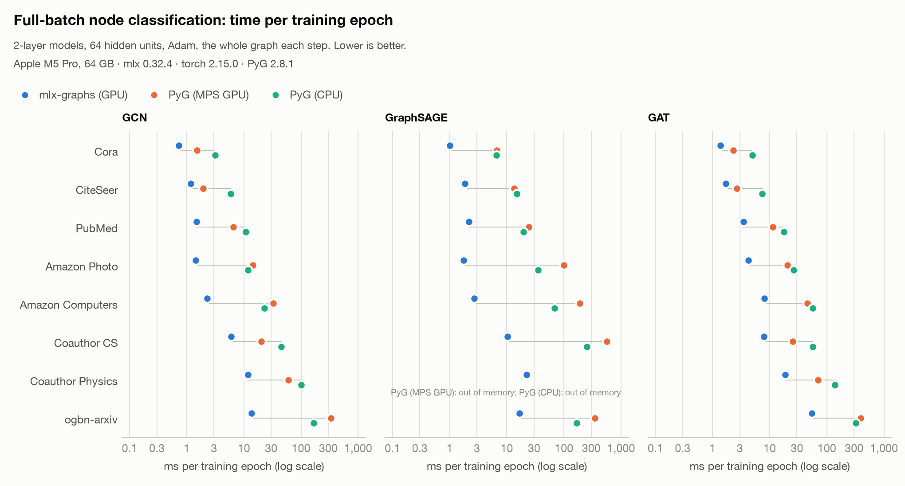

______________________________________________________________________

**[Documentation](https://mlx-graphs.github.io/mlx-graphs/)** | **[Quickstart](https://mlx-graphs.github.io/mlx-graphs/tutorials/quickstart.html)** | **[Discord](https://discord.gg/K3mWFCxxM7)**

MLX-graphs is a library for Graph Neural Networks (GNNs) built upon Apple's [MLX](https://github.com/ml-explore/mlx).


## Features

- **Fast GNN training and inference on Apple Silicon.**
   Message passing runs on the Mac's GPU through MLX and fused sparse
   kernels: neighbours are aggregated with one sparse x dense matmul (SpMM)
   instead of building a `[num_edges, features]` message array, including for
   the attention layers (one SpMM per head). See the [benchmarks](#benchmarks-vs-pytorch-geometric) below.
- **A PyG-style API.** `MessagePassing`, `GraphData` / batching, datasets,
  transforms and utilities follow PyTorch Geometric's design, so porting a
  PyG model is mostly mechanical. `from_pyg` / `to_pyg` convert graphs both ways.
- **Scalability to large graphs.** With unified memory, the whole memory of
  the Mac is available to the GPU, and fused message passing keeps the peak
  memory of a layer close to the size of its inputs and outputs.

### What's included

| | |
|---|---|
| **Convolutions** | `GCNConv`, `SAGEConv`, `GINConv` (+ GINE), `GATConv`, `GATv2Conv`, `TransformerConv`, `GraphConv`, `SGConv`, `APPNP`, `ChebConv`, `TAGConv`, `EdgeConv`, `RGCNConv`, `SimpleConv`, `GeneralizedRelationalConv`, `HeteroConv` |
| **Models** | `GCN`, `GraphSAGE`, `GIN`, `GAT` (v1/v2), `MLP`: multi-layer, with dropout, batch/layer norm and Jumping Knowledge |
| **Pooling / readout** | `global_{add,mean,max}_pool`, `AttentionalAggregation`, `Set2Set`, `JumpingKnowledge` |
| **Normalization** | `BatchNormalization`, `LayerNormalization`, `InstanceNormalization` (+ heterogeneous variants) |
| **Data** | `GraphData`, `HeteroGraphData`, `GraphDataBatch`, `Dataloader`, `NeighborLoader` (homogeneous and heterogeneous) |
| **Datasets** | Planetoid (Cora, CiteSeer, PubMed), Amazon (Computers, Photo), Coauthor (CS, Physics), OGB, TU datasets, QM7b, superpixels, Elliptic, MovieLens, IMDB, DBLP, Karate Club |
| **Transforms** | `Compose`, `ToUndirected`, `AddSelfLoops`, `RemoveSelfLoops`, `RemoveIsolatedNodes`, `LargestConnectedComponents`, `RandomNodeSplit`, `RandomLinkSplit`, `OneHotDegree`, `Constant`, `AddRandomWalkPE`, `GCNNorm`, `FeaturesNormalizedTransform` |
| **Utilities** | `subgraph`, `k_hop_subgraph`, `negative_sampling`, `structured_negative_sampling`, `dropout_edge`, `dropout_node`, `to_dense_batch`, `to_dense_adj`, `get_laplacian`, `homophily`, `coalesce`, `to_undirected`, `scatter`, `degree`, `from_pyg` / `to_pyg`, `from_networkx` / `to_networkx` |
| **Algorithms** | `Node2Vec` |

## Benchmarks vs PyTorch Geometric

Measured on an Apple M5 Pro (64 GB) against PyTorch Geometric 2.8.1 /
PyTorch 2.15, on both of PyTorch's backends (MPS GPU and CPU), same models,
same data, same hyperparameters:

- **One layer, forward + backward** on a 2M-edge graph: **9–31× faster than
  PyG on MPS** and 6–15× faster than PyG on CPU for GCN, GraphSAGE, GIN and
  GAT, with 1.5–3.3× less peak memory. GATv2, which needs per-edge features for
  its dynamic attention, is ~3× faster at similar memory.
- **Full-batch node classification** on 8 datasets (Cora to ogbn-arxiv):
  **1.6–70× faster per epoch than PyG on MPS** (25× for GCN on ogbn-arxiv,
  55–70× for GraphSAGE on Amazon/Coauthor), at comparable accuracy
  (single seed; within ~4 points either way). On
  Coauthor Physics, PyG's GraphSAGE goes over a 16 GB memory cap on both
  backends; mlx-graphs trains it at 4.7 GB.
- **Graph classification** with mini-batches of small graphs (MUTAG,
  PROTEINS, NCI1, DD), including batching: 3–10× faster than PyG on MPS and
  1.6–4.7× faster than PyG on CPU.

<picture>
  <source media="(prefers-color-scheme: dark)" srcset="benchmarks/pyg_comparison/results/Apple_M5_Pro/figures/layers_speedup_dark.png">
  
</picture>

<picture>
  <source media="(prefers-color-scheme: dark)" srcset="benchmarks/pyg_comparison/results/Apple_M5_Pro/figures/node_classification_dark.png">
  
</picture>

More figures (absolute layer timings, peak memory, graph classification),
every number as a table, and how the comparison was made are in
[`benchmarks/pyg_comparison`](benchmarks/pyg_comparison/README.md); the
tables are in [`results.md`](benchmarks/pyg_comparison/results/Apple_M5_Pro/results.md).
To reproduce on your Mac:

```bash
pip install -e '.[benchmarks]'
python benchmarks/pyg_comparison/run.py && python benchmarks/pyg_comparison/plot.py
```

## Installation
`mlx-graphs` is available on Pypi. To install run
```
pip install mlx-graphs
```
### Build from source

To build and install `mlx-graphs` from source start by cloning the github repo
```
git clone git@github.com:mlx-graphs/mlx-graphs.git && cd mlx-graphs
```
Create a new virtual environment and install the requirements
```
pip install -e .
```

## Usage

### Tutorial guides

We provide some notebooks to practice `mlx-graphs`.

- Quickstart guide: [notebook](https://mlx-graphs.github.io/mlx-graphs/tutorials/quickstart.html)
- Graph classification guide: [notebook](https://mlx-graphs.github.io/mlx-graphs/tutorials/graph_classification.html)

Runnable scripts are in [`examples/`](examples), e.g.
[`node_classification.py`](examples/node_classification.py) and
[`link_prediction.py`](examples/link_prediction.py).

### Training a model

```python
import mlx.core as mx
import mlx.nn as nn
import mlx.optimizers as optim
import numpy as np

from mlx_graphs.datasets import PlanetoidDataset
from mlx_graphs.nn import GCN

graph = PlanetoidDataset("cora")[0]
train = mx.array(np.nonzero(np.array(graph.train_mask))[0])
labels = graph.node_labels

model = GCN(graph.num_node_features, 64, num_layers=2, out_features_dim=7, dropout=0.5)
# bias_correction=True: the same update rule as torch.optim.Adam
optimizer = optim.Adam(learning_rate=0.01, bias_correction=True)


def loss_fn(model):
    logits = model(graph.edge_index, graph.node_features)
    return nn.losses.cross_entropy(logits[train], labels[train], reduction="mean")


loss_and_grad = nn.value_and_grad(model, loss_fn)
for epoch in range(200):
    loss, grads = loss_and_grad(model)
    optimizer.update(model, grads)
    mx.eval(model.parameters(), optimizer.state)
```

> [!TIP]
> Create MLX's `Adam`/`AdamW` with `bias_correction=True`. MLX's default
> (no bias correction) takes much larger first steps than PyTorch's Adam;
> in our runs it cost GAT about 4 points of accuracy on Cora.

### Writing a layer
Building new GNN layers is straightforward by implementing the `MessagePassing` class. This approach ensures that all operations related to message passing are properly handled and processed efficiently on your Mac's GPU. As a result, you can focus exclusively on the GNN logic, without worrying about the underlying message passing mechanics.

Here is an example of a custom [GraphSAGE](https://proceedings.neurips.cc/paper_files/paper/2017/file/5dd9db5e033da9c6fb5ba83c7a7ebea9-Paper.pdf) convolutional layer that considers edge weights:

```python
import mlx.core as mx
from mlx_graphs.nn.linear import Linear
from mlx_graphs.nn.message_passing import MessagePassing, fused_message_passing


@fused_message_passing  # aggregate with one SpMM instead of gather-scatter
class SAGEConv(MessagePassing):
    def __init__(self, node_features_dim: int, out_features_dim: int, bias: bool = True):
        super().__init__(aggr="mean")
        self.neigh_proj = Linear(node_features_dim, out_features_dim, bias=False)
        self.self_proj = Linear(node_features_dim, out_features_dim, bias=bias)

    def __call__(self, edge_index: mx.array, node_features: mx.array, edge_weights: mx.array) -> mx.array:
        # Message passing directly on GPU. The default message is
        # edge_weights * source features, which the fused kernel computes.
        neigh_features = self.propagate(
            edge_index=edge_index,
            node_features=node_features,
            message_kwargs={"edge_weights": edge_weights},
        )
        return self.self_proj(node_features) + self.neigh_proj(neigh_features)
```

Layers that override `message()` with something other than a weighted sum
of neighbour features (e.g. attention computed per edge) simply drop the
decorator, and `propagate` gathers per-edge messages and scatters them.

## Contributing
### Why contributing?

We are at an early stage of the development of the lib, which means your contributions can have a large impact!
Everyone is welcome to contribute, just open an issue 📝 with your idea 💡 and we'll work together on the implementation ✨.

> [!NOTE]
> Contributions such as the implementation of new layers and datasets would be very valuable for the library.

### Installing test, dev, benchmaks, docs dependencies
Extra dependencies are specified in the `pyproject.toml`.
To install those required for testing, development and building documentation, you can run any of the following
```
pip install -e '.[test]'
pip install -e '.[dev]'
pip install -e '.[benchmarks]'
pip install -e '.[docs]'
```
For dev purposes you may want to install the current version of `mlx` via `pip install git+https://github.com/ml-explore/mlx.git`

### Testing
We encourage to write tests for all components.
Please run `pytest` to ensure breaking changes are not introduced.

> Note: CI is in place to automatically run tests upon opening a PR.

### Pre-commit hooks (optional)
To ensure code quality you can run [pre-commit](https://pre-commit.com) hooks. Simply install them by running
```
pre-commit install
```
and run via `pre-commit run --all-files`.

> Note: CI is in place to verify code quality, so pull requests that don't meet those requirements won't pass CI tests.


## Why running GNNs on my Mac?

Other frameworks like PyG and DGL also benefit from efficient GNN operations parallelized on GPU. However, they are not fully optimized to leverage the Mac's GPU capabilities, often defaulting to CPU execution.

In contrast, `mlx-graphs` is specifically designed to leverage the power of Mac's hardware, delivering optimal performance for Mac users. By taking advantage of Apple Silicon, `mlx-graphs` enables accelerated GPU computation and benefits from unified memory. This approach removes the need for data transfers between devices and allows for the use of the entire memory space available on the Mac's GPU. Consequently, users can manage large graphs directly on the GPU, enhancing performance and efficiency.
