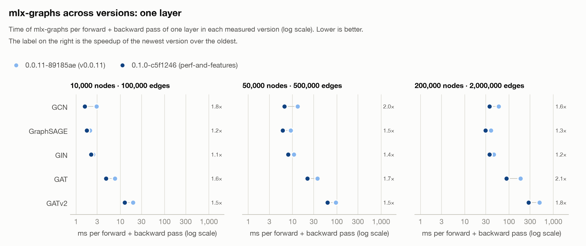
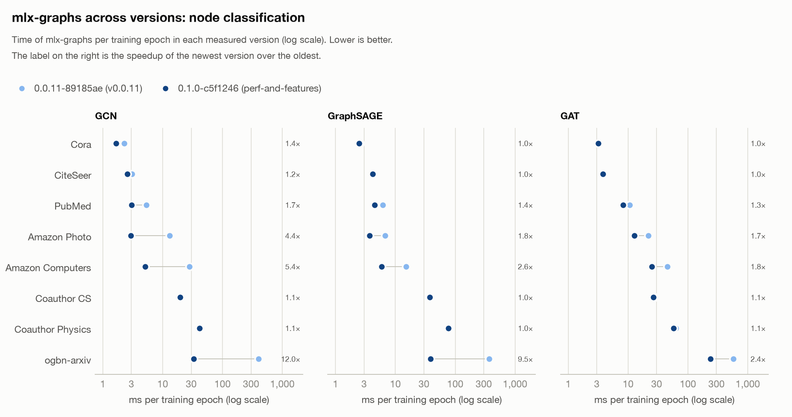
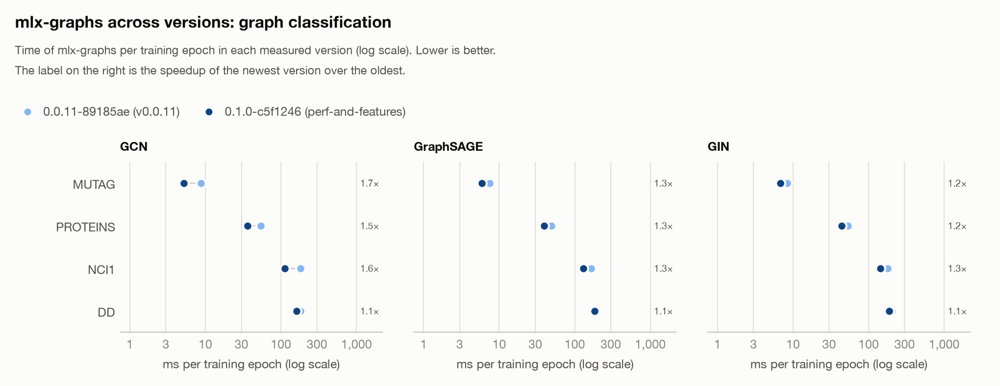

# mlx-graphs across versions

Benchmark results of every version of mlx-graphs measured on this machine (Apple M1 Pro, 32 GB), oldest first. Each version is a directory next to this file, with its own `results.md`. Regenerate with `python benchmarks/pyg_comparison/history.py`.

| version | branch | library commit | date | mlx | torch / PyG |
|---|---|---|---|---|---|
| [0.0.11-89185ae](0.0.11-89185ae/results.md) | v0.0.11 | `89185ae` Node2 vec bug fix (#201) | 2026-11-20 | 0.32.4 | 2.15.0 / 2.8.1 |
| [0.1.0-c5f1246](0.1.0-c5f1246/results.md) | perf-and-features | `c5f1246` Faster message passing, PyG-parity layers and models, PyG benchmarks | 2026-11-20 | 0.32.4 | 2.15.0 / 2.8.1 |

Speedup columns compare the newest version (0.1.0-c5f1246 (perf-and-features)) with the oldest (0.0.11-89185ae (v0.0.11)). Times are medians, accuracies are mean ± standard deviation over seeds.

## One layer, forward + backward

<picture>
  <source media="(prefers-color-scheme: dark)" srcset="figures/history_layer_dark.png">
  
</picture>

mlx-graphs time (ms per pass):

| | | 0.0.11-89185ae (v0.0.11) | 0.1.0-c5f1246 (perf-and-features) | speedup |
|---|---|---:|---:|---:|
| 10,000 nodes · 100,000 edges | GCN | 2.88 | 1.56 | 1.8× |
| 10,000 nodes · 100,000 edges | GraphSAGE | 2.04 | 1.75 | 1.2× |
| 10,000 nodes · 100,000 edges | GIN | 2.42 | 2.19 | 1.1× |
| 10,000 nodes · 100,000 edges | GAT | 7.55 | 4.73 | 1.6× |
| 10,000 nodes · 100,000 edges | GATv2 | 19.16 | 12.47 | 1.5× |
| 50,000 nodes · 500,000 edges | GCN | 12.97 | 6.56 | 2.0× |
| 50,000 nodes · 500,000 edges | GraphSAGE | 9.07 | 6.02 | 1.5× |
| 50,000 nodes · 500,000 edges | GIN | 10.79 | 7.92 | 1.4× |
| 50,000 nodes · 500,000 edges | GAT | 36.49 | 21.46 | 1.7× |
| 50,000 nodes · 500,000 edges | GATv2 | 94.54 | 61.66 | 1.5× |
| 200,000 nodes · 2,000,000 edges | GCN | 58.07 | 36.36 | 1.6× |
| 200,000 nodes · 2,000,000 edges | GraphSAGE | 39.08 | 29.56 | 1.3× |
| 200,000 nodes · 2,000,000 edges | GIN | 45.14 | 36.27 | 1.2× |
| 200,000 nodes · 2,000,000 edges | GAT | 182.53 | 87.74 | 2.1× |
| 200,000 nodes · 2,000,000 edges | GATv2 | 484.63 | 276.49 | 1.8× |

Peak memory (GB) of mlx-graphs:

| | | 0.0.11-89185ae (v0.0.11) | 0.1.0-c5f1246 (perf-and-features) |
|---|---|---:|---:|
| 10,000 nodes · 100,000 edges | GCN | 0.08 | 0.10 |
| 10,000 nodes · 100,000 edges | GraphSAGE | 0.09 | 0.10 |
| 10,000 nodes · 100,000 edges | GIN | 0.13 | 0.11 |
| 10,000 nodes · 100,000 edges | GAT | 0.37 | 0.19 |
| 10,000 nodes · 100,000 edges | GATv2 | 0.81 | 0.55 |
| 50,000 nodes · 500,000 edges | GCN | 0.24 | 0.33 |
| 50,000 nodes · 500,000 edges | GraphSAGE | 0.34 | 0.28 |
| 50,000 nodes · 500,000 edges | GIN | 0.42 | 0.36 |
| 50,000 nodes · 500,000 edges | GAT | 1.71 | 0.78 |
| 50,000 nodes · 500,000 edges | GATv2 | 2.84 | 2.26 |
| 200,000 nodes · 2,000,000 edges | GCN | 0.85 | 1.01 |
| 200,000 nodes · 2,000,000 edges | GraphSAGE | 0.82 | 0.92 |
| 200,000 nodes · 2,000,000 edges | GIN | 1.22 | 1.32 |
| 200,000 nodes · 2,000,000 edges | GAT | 6.73 | 2.54 |
| 200,000 nodes · 2,000,000 edges | GATv2 | 11.12 | 6.87 |

## Full-batch node classification

<picture>
  <source media="(prefers-color-scheme: dark)" srcset="figures/history_node_dark.png">
  
</picture>

mlx-graphs time (ms per epoch):

| | | 0.0.11-89185ae (v0.0.11) | 0.1.0-c5f1246 (perf-and-features) | speedup |
|---|---|---:|---:|---:|
| GCN | Cora | 2.29 | 1.66 | 1.4× |
| GCN | CiteSeer | 3.09 | 2.56 | 1.2× |
| GCN | PubMed | 5.31 | 3.04 | 1.7× |
| GCN | Amazon Photo | 13.00 | 2.95 | 4.4× |
| GCN | Amazon Computers | 28.02 | 5.14 | 5.4× |
| GCN | Coauthor CS | 20.74 | 19.61 | 1.1× |
| GCN | Coauthor Physics | 43.55 | 41.14 | 1.1× |
| GCN | ogbn-arxiv | 398.35 | 33.28 | 12.0× |
| GraphSAGE | Cora | 2.58 | 2.49 | 1.0× |
| GraphSAGE | CiteSeer | 4.24 | 4.18 | 1.0× |
| GraphSAGE | PubMed | 6.20 | 4.51 | 1.4× |
| GraphSAGE | Amazon Photo | 6.77 | 3.72 | 1.8× |
| GraphSAGE | Amazon Computers | 15.19 | 5.89 | 2.6× |
| GraphSAGE | Coauthor CS | 37.75 | 37.83 | 1.0× |
| GraphSAGE | Coauthor Physics | 78.78 | 77.04 | 1.0× |
| GraphSAGE | ogbn-arxiv | 368.10 | 38.62 | 9.5× |
| GAT | Cora | 3.15 | 3.17 | 1.0× |
| GAT | CiteSeer | 3.89 | 3.79 | 1.0× |
| GAT | PubMed | 10.62 | 8.27 | 1.3× |
| GAT | Amazon Photo | 21.66 | 12.82 | 1.7× |
| GAT | Amazon Computers | 45.06 | 24.92 | 1.8× |
| GAT | Coauthor CS | 28.17 | 26.35 | 1.1× |
| GAT | Coauthor Physics | 62.91 | 57.52 | 1.1× |
| GAT | ogbn-arxiv | 578.13 | 238.04 | 2.4× |

Test accuracy of mlx-graphs:

| | | 0.0.11-89185ae (v0.0.11) | 0.1.0-c5f1246 (perf-and-features) |
|---|---|---:|---:|
| GCN | Cora | 0.805 ± 0.011 | 0.807 ± 0.009 |
| GCN | CiteSeer | 0.675 ± 0.003 | 0.662 ± 0.001 |
| GCN | PubMed | 0.765 ± 0.003 | 0.766 ± 0.002 |
| GCN | Amazon Photo | 0.907 ± 0.007 | 0.903 ± 0.006 |
| GCN | Amazon Computers | 0.817 ± 0.002 | 0.799 ± 0.003 |
| GCN | Coauthor CS | 0.904 ± 0.006 | 0.903 ± 0.002 |
| GCN | Coauthor Physics | 0.925 ± 0.004 | 0.928 ± 0.005 |
| GCN | ogbn-arxiv | 0.625 ± 0.005 | 0.633 ± 0.006 |
| GraphSAGE | Cora | 0.783 ± 0.005 | 0.799 ± 0.009 |
| GraphSAGE | CiteSeer | 0.667 ± 0.006 | 0.664 ± 0.007 |
| GraphSAGE | PubMed | 0.750 ± 0.005 | 0.750 ± 0.008 |
| GraphSAGE | Amazon Photo | 0.755 ± 0.076 | 0.908 ± 0.005 |
| GraphSAGE | Amazon Computers | 0.679 ± 0.027 | 0.783 ± 0.008 |
| GraphSAGE | Coauthor CS | 0.893 ± 0.003 | 0.892 ± 0.006 |
| GraphSAGE | Coauthor Physics | 0.923 ± 0.004 | 0.919 ± 0.008 |
| GraphSAGE | ogbn-arxiv | 0.649 ± 0.003 | 0.642 ± 0.004 |
| GAT | Cora | 0.795 ± 0.014 | 0.792 ± 0.014 |
| GAT | CiteSeer | 0.654 ± 0.021 | 0.656 ± 0.015 |
| GAT | PubMed | 0.738 ± 0.007 | 0.739 ± 0.006 |
| GAT | Amazon Photo | 0.889 ± 0.018 | 0.888 ± 0.015 |
| GAT | Amazon Computers | 0.844 ± 0.007 | 0.826 ± 0.028 |
| GAT | Coauthor CS | 0.886 ± 0.003 | 0.888 ± 0.003 |
| GAT | Coauthor Physics | 0.905 ± 0.014 | 0.910 ± 0.007 |
| GAT | ogbn-arxiv | 0.649 ± 0.005 | 0.649 ± 0.004 |

## Graph classification

<picture>
  <source media="(prefers-color-scheme: dark)" srcset="figures/history_graph_dark.png">
  
</picture>

mlx-graphs time (ms per epoch):

| | | 0.0.11-89185ae (v0.0.11) | 0.1.0-c5f1246 (perf-and-features) | speedup |
|---|---|---:|---:|---:|
| GCN | MUTAG | 8.76 | 5.18 | 1.7× |
| GCN | PROTEINS | 54.48 | 35.93 | 1.5× |
| GCN | NCI1 | 182.73 | 112.83 | 1.6× |
| GCN | DD | 181.88 | 161.95 | 1.1× |
| GraphSAGE | MUTAG | 7.54 | 5.89 | 1.3× |
| GraphSAGE | PROTEINS | 49.26 | 39.06 | 1.3× |
| GraphSAGE | NCI1 | 164.33 | 130.53 | 1.3× |
| GraphSAGE | DD | 195.26 | 183.95 | 1.1× |
| GIN | MUTAG | 8.32 | 6.78 | 1.2× |
| GIN | PROTEINS | 53.42 | 43.84 | 1.2× |
| GIN | NCI1 | 179.14 | 143.00 | 1.3× |
| GIN | DD | 203.12 | 187.84 | 1.1× |

Test accuracy of mlx-graphs:

| | | 0.0.11-89185ae (v0.0.11) | 0.1.0-c5f1246 (perf-and-features) |
|---|---|---:|---:|
| GCN | MUTAG | 0.600 ± 0.082 | 0.600 ± 0.041 |
| GCN | PROTEINS | 0.759 ± 0.019 | 0.747 ± 0.030 |
| GCN | NCI1 | 0.656 ± 0.005 | 0.671 ± 0.015 |
| GCN | DD | 0.709 ± 0.017 | 0.709 ± 0.069 |
| GraphSAGE | MUTAG | 0.633 ± 0.125 | 0.600 ± 0.122 |
| GraphSAGE | PROTEINS | 0.726 ± 0.030 | 0.729 ± 0.028 |
| GraphSAGE | NCI1 | 0.693 ± 0.016 | 0.693 ± 0.030 |
| GraphSAGE | DD | 0.703 ± 0.055 | 0.737 ± 0.044 |
| GIN | MUTAG | 0.633 ± 0.143 | 0.667 ± 0.094 |
| GIN | PROTEINS | 0.735 ± 0.030 | 0.729 ± 0.041 |
| GIN | NCI1 | 0.673 ± 0.020 | 0.586 ± 0.078 |
| GIN | DD | 0.703 ± 0.097 | 0.697 ± 0.034 |
