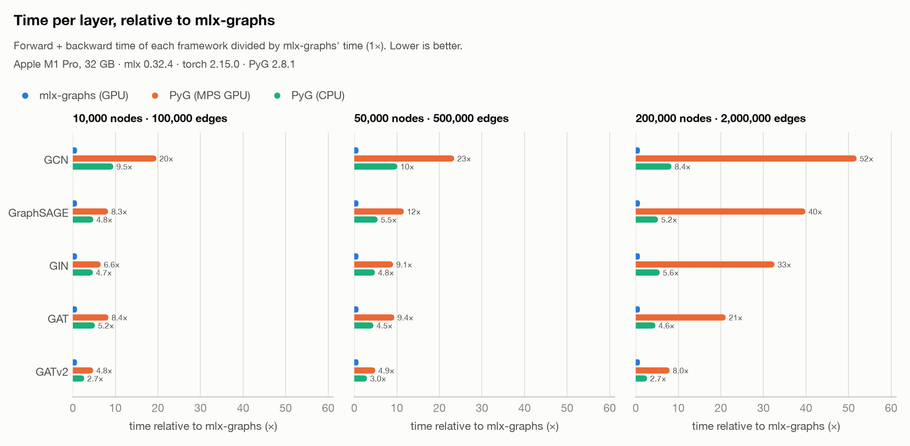
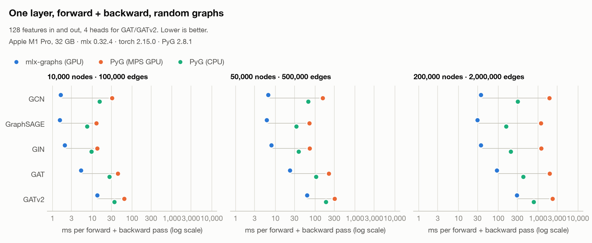
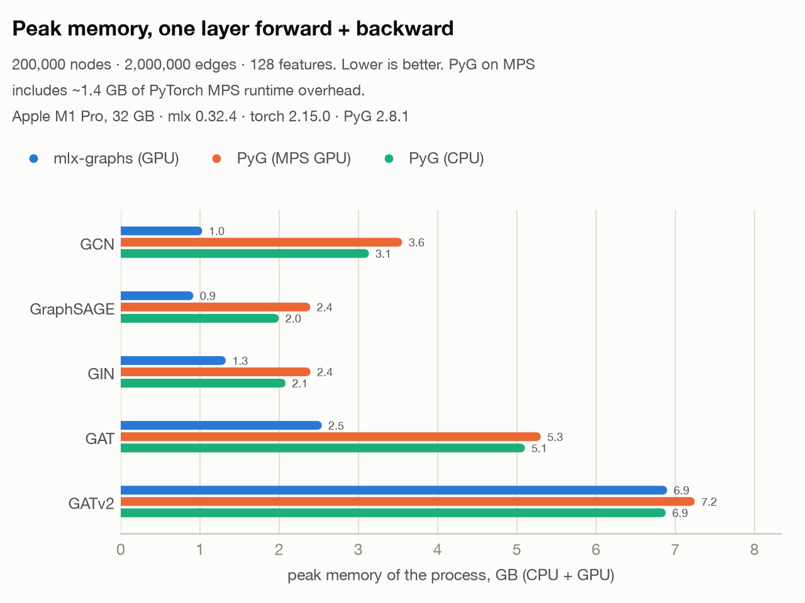
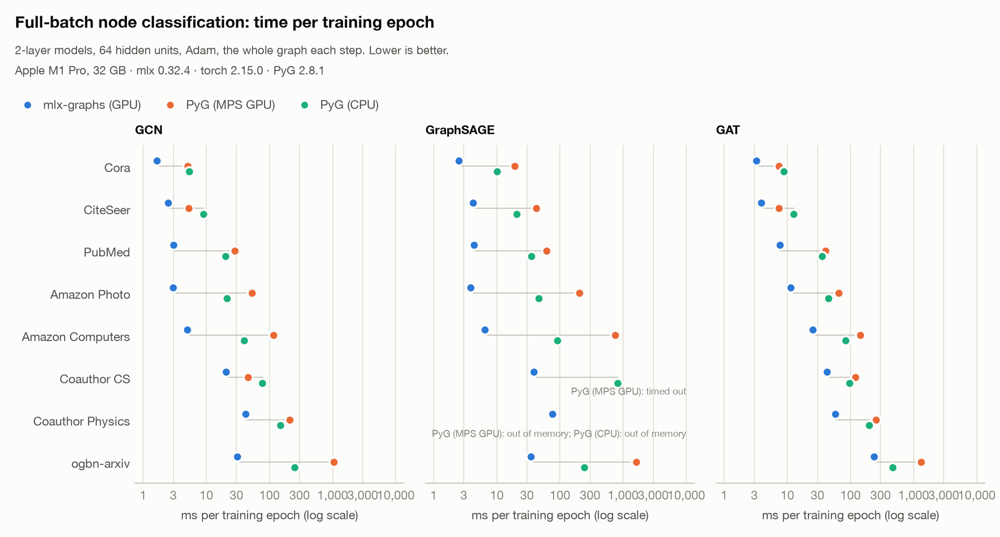
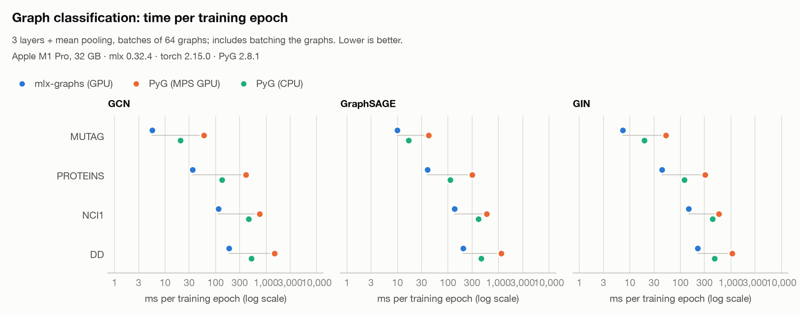

# mlx-graphs vs PyTorch Geometric

Machine: Apple M1 Pro, 32 GB, macOS 27.0. mlx 0.32.4, mlx-graphs 0.0.11, mlx-cluster 0.1.2, torch 2.15.0, torch_geometric 2.8.1, Python 3.12.10.

Times are medians in milliseconds; lower is better. Speedup is the PyG time divided by the mlx-graphs time.

## One layer, forward + backward

Random graphs, 128 input and output features, 4 heads for GAT/GATv2.

<picture>
  <source media="(prefers-color-scheme: dark)" srcset="figures/layers_speedup_dark.png">
  
</picture>

<picture>
  <source media="(prefers-color-scheme: dark)" srcset="figures/layers_time_dark.png">
  
</picture>

<picture>
  <source media="(prefers-color-scheme: dark)" srcset="figures/layers_memory_dark.png">
  
</picture>

| graph | layer | mlx-graphs | PyG MPS | PyG CPU | speedup vs MPS | speedup vs CPU | peak GB mlx / MPS / CPU |
|---|---|---:|---:|---:|---:|---:|---|
| 10,000 nodes, 100,000 edges | GCN | 1.60 | 31.32 | 15.17 | 19.6× | 9.5× | 0.1 / 1.3 / 0.4 |
| 10,000 nodes, 100,000 edges | GraphSAGE | 1.53 | 12.69 | 7.38 | 8.3× | 4.8× | 0.1 / 1.3 / 0.4 |
| 10,000 nodes, 100,000 edges | GIN | 2.03 | 13.28 | 9.52 | 6.6× | 4.7× | 0.1 / 1.3 / 0.4 |
| 10,000 nodes, 100,000 edges | GAT | 5.22 | 43.65 | 27.06 | 8.4× | 5.2× | 0.2 / 1.3 / 0.5 |
| 10,000 nodes, 100,000 edges | GATv2 | 13.26 | 63.40 | 35.46 | 4.8× | 2.7× | 0.6 / 1.3 / 0.6 |
| 50,000 nodes, 500,000 edges | GCN | 6.56 | 154.09 | 66.34 | 23.5× | 10.1× | 0.3 / 1.4 / 1.0 |
| 50,000 nodes, 500,000 edges | GraphSAGE | 6.07 | 70.75 | 33.31 | 11.6× | 5.5× | 0.3 / 1.4 / 0.7 |
| 50,000 nodes, 500,000 edges | GIN | 7.89 | 71.86 | 38.24 | 9.1× | 4.8× | 0.4 / 1.4 / 0.7 |
| 50,000 nodes, 500,000 edges | GAT | 23.15 | 217.83 | 104.12 | 9.4× | 4.5× | 0.8 / 2.4 / 1.5 |
| 50,000 nodes, 500,000 edges | GATv2 | 61.94 | 305.59 | 185.13 | 4.9× | 3.0× | 2.3 / 2.4 / 1.9 |
| 200,000 nodes, 2,000,000 edges | GCN | 36.65 | 1,901.26 | 307.49 | 51.9× | 8.4× | 1.0 / 3.6 / 3.1 |
| 200,000 nodes, 2,000,000 edges | GraphSAGE | 29.68 | 1,182.71 | 155.43 | 39.8× | 5.2× | 0.9 / 2.4 / 2.0 |
| 200,000 nodes, 2,000,000 edges | GIN | 36.50 | 1,189.34 | 205.78 | 32.6× | 5.6× | 1.3 / 2.4 / 2.1 |
| 200,000 nodes, 2,000,000 edges | GAT | 91.84 | 1,940.94 | 424.07 | 21.1× | 4.6× | 2.5 / 5.3 / 5.1 |
| 200,000 nodes, 2,000,000 edges | GATv2 | 291.08 | 2,316.54 | 775.86 | 8.0× | 2.7× | 6.9 / 7.2 / 6.9 |

## Full-batch node classification

Median time per training epoch. Test accuracy at the best validation epoch.

<picture>
  <source media="(prefers-color-scheme: dark)" srcset="figures/node_classification_dark.png">
  
</picture>

| dataset | model | mlx-graphs | PyG MPS | PyG CPU | speedup vs MPS | speedup vs CPU | accuracy mlx / MPS / CPU |
|---|---|---:|---:|---:|---:|---:|---|
| Cora | GCN | 1.63 | 5.04 | 5.36 | 3.1× | 3.3× | 0.807 / 0.814 / 0.807 |
| Cora | GraphSAGE | 2.52 | 19.29 | 10.12 | 7.7× | 4.0× | 0.797 / 0.789 / 0.784 |
| Cora | GAT | 3.21 | 7.39 | 8.76 | 2.3× | 2.7× | 0.802 / 0.811 / 0.804 |
| CiteSeer | GCN | 2.46 | 5.27 | 9.06 | 2.1× | 3.7× | 0.663 / 0.650 / 0.655 |
| CiteSeer | GraphSAGE | 4.22 | 42.35 | 20.61 | 10.0× | 4.9× | 0.659 / 0.666 / 0.644 |
| CiteSeer | GAT | 3.84 | 7.32 | 12.59 | 1.9× | 3.3× | 0.667 / 0.637 / 0.653 |
| PubMed | GCN | 3.03 | 28.44 | 20.03 | 9.4× | 6.6× | 0.768 / 0.766 / 0.758 |
| PubMed | GraphSAGE | 4.36 | 61.51 | 34.92 | 14.1× | 8.0× | 0.746 / 0.757 / 0.757 |
| PubMed | GAT | 7.66 | 40.29 | 35.12 | 5.3× | 4.6× | 0.745 / 0.766 / 0.770 |
| Amazon Photo | GCN | 2.95 | 52.79 | 21.03 | 17.9× | 7.1× | 0.902 / 0.900 / 0.887 |
| Amazon Photo | GraphSAGE | 3.81 | 202.07 | 46.06 | 53.0× | 12.1× | 0.902 / 0.902 / 0.909 |
| Amazon Photo | GAT | 11.36 | 65.28 | 44.77 | 5.7× | 3.9× | 0.875 / 0.877 / 0.886 |
| Amazon Computers | GCN | 4.95 | 116.28 | 39.40 | 23.5× | 8.0× | 0.800 / 0.838 / 0.816 |
| Amazon Computers | GraphSAGE | 6.47 | 742.79 | 90.92 | 114.8× | 14.1× | 0.795 / 0.779 / 0.786 |
| Amazon Computers | GAT | 25.12 | 141.65 | 83.33 | 5.6× | 3.3× | 0.844 / 0.780 / 0.827 |
| Coauthor CS | GCN | 20.53 | 45.79 | 77.03 | 2.2× | 3.8× | 0.900 / 0.896 / 0.898 |
| Coauthor CS | GraphSAGE | 38.60 | timed out | 819.13 | – | 21.2× | 0.884 / timed out / 0.894 |
| Coauthor CS | GAT | 42.03 | 119.78 | 97.02 | 2.8× | 2.3× | 0.883 / 0.878 / 0.872 |
| Coauthor Physics | GCN | 41.46 | 207.97 | 149.08 | 5.0× | 3.6× | 0.934 / 0.931 / 0.933 |
| Coauthor Physics | GraphSAGE | 75.28 | out of memory | out of memory | – | – | 0.909 / out of memory / out of memory |
| Coauthor Physics | GAT | 57.93 | 251.77 | 198.76 | 4.3× | 3.4× | 0.901 / 0.920 / 0.920 |
| ogbn-arxiv | GCN | 31.11 | 1,044.00 | 250.49 | 33.6× | 8.1× | 0.625 / 0.631 / 0.637 |
| ogbn-arxiv | GraphSAGE | 34.61 | 1,620.79 | 240.66 | 46.8× | 7.0× | 0.638 / 0.645 / 0.645 |
| ogbn-arxiv | GAT | 233.79 | 1,308.95 | 464.60 | 5.6× | 2.0× | 0.653 / 0.649 / 0.651 |

## Graph classification

Median time per training epoch. Test accuracy after the last epoch (80/20 random split).

<picture>
  <source media="(prefers-color-scheme: dark)" srcset="figures/graph_classification_dark.png">
  
</picture>

| dataset | model | mlx-graphs | PyG MPS | PyG CPU | speedup vs MPS | speedup vs CPU | accuracy mlx / MPS / CPU |
|---|---|---:|---:|---:|---:|---:|---|
| MUTAG | GCN | 5.56 | 58.45 | 20.07 | 10.5× | 3.6× | 0.737 / 0.605 / 0.763 |
| MUTAG | GraphSAGE | 9.92 | 41.36 | 16.54 | 4.2× | 1.7× | 0.711 / 0.763 / 0.711 |
| MUTAG | GIN | 7.27 | 51.24 | 19.44 | 7.0× | 2.7× | 0.605 / 0.684 / 0.711 |
| PROTEINS | GCN | 35.21 | 399.72 | 133.00 | 11.4× | 3.8× | 0.700 / 0.762 / 0.740 |
| PROTEINS | GraphSAGE | 39.54 | 299.04 | 111.43 | 7.6× | 2.8× | 0.726 / 0.749 / 0.735 |
| PROTEINS | GIN | 43.46 | 305.71 | 119.74 | 7.0× | 2.8× | 0.664 / 0.771 / 0.659 |
| NCI1 | GCN | 113.58 | 739.83 | 449.59 | 6.5× | 4.0× | 0.690 / 0.691 / 0.687 |
| NCI1 | GraphSAGE | 133.99 | 583.32 | 402.33 | 4.4× | 3.0× | 0.700 / 0.708 / 0.670 |
| NCI1 | GIN | 146.36 | 574.46 | 432.95 | 3.9× | 3.0× | 0.592 / 0.498 / 0.661 |
| DD | GCN | 183.08 | 1,471.38 | 510.69 | 8.0× | 2.8× | 0.729 / 0.792 / 0.750 |
| DD | GraphSAGE | 201.03 | 1,131.95 | 452.70 | 5.6× | 2.3× | 0.716 / 0.775 / 0.788 |
| DD | GIN | 218.35 | 1,066.83 | 469.85 | 4.9× | 2.2× | 0.763 / 0.576 / 0.742 |
