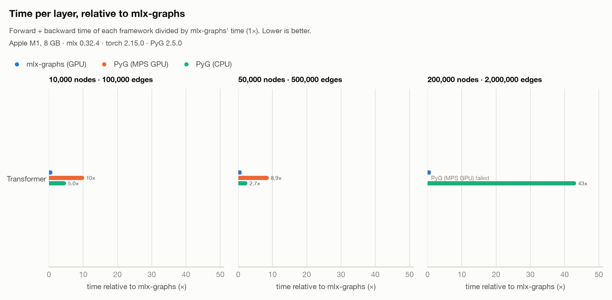
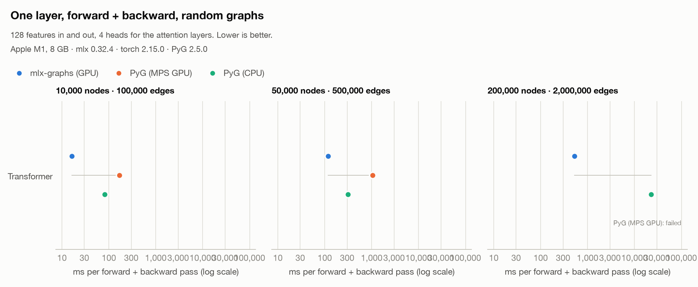
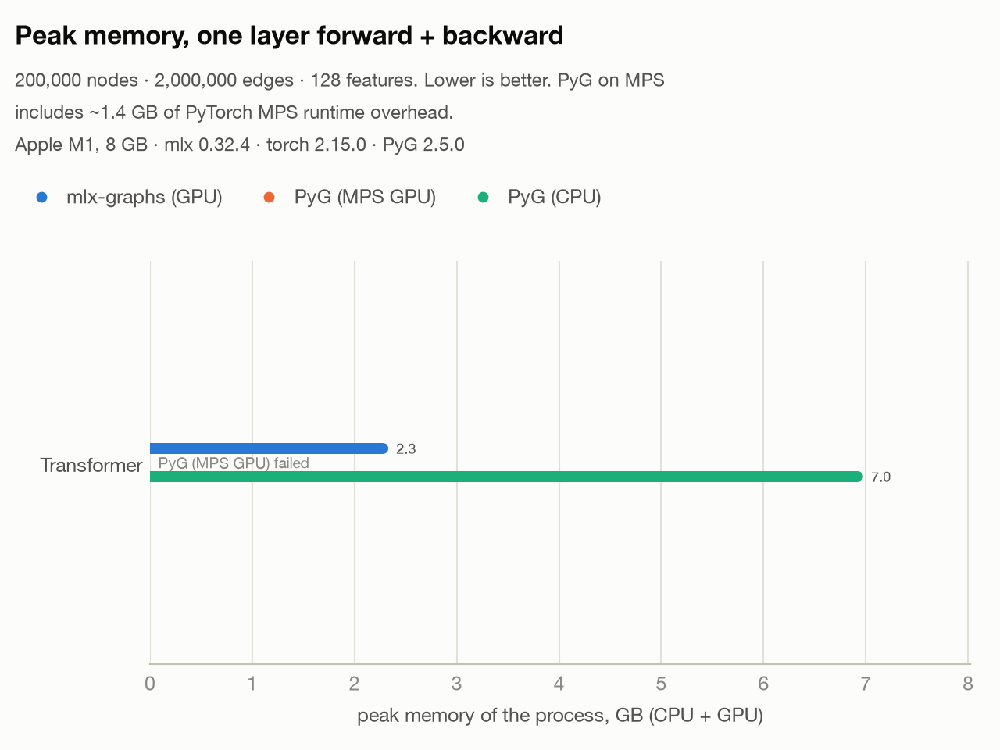

# mlx-graphs vs PyTorch Geometric

Machine: Apple M1, 8 GB, macOS 26.1. mlx 0.32.4, mlx-graphs 0.2.0, mlx-cluster 0.1.2, torch 2.15.0, torch_geometric 2.5.0, Python 3.13.5.

Times are medians in milliseconds; lower is better. Speedup is the PyG time divided by the mlx-graphs time.

## One layer, forward + backward

Random graphs, 128 input and output features, 4 heads for the attention layers.

<picture>
  <source media="(prefers-color-scheme: dark)" srcset="figures/layers_speedup_dark.png">
  
</picture>

<picture>
  <source media="(prefers-color-scheme: dark)" srcset="figures/layers_time_dark.png">
  
</picture>

<picture>
  <source media="(prefers-color-scheme: dark)" srcset="figures/layers_memory_dark.png">
  
</picture>

| graph | layer | mlx-graphs | PyG MPS | PyG CPU | speedup vs MPS | speedup vs CPU | peak GB mlx / MPS / CPU |
|---|---|---:|---:|---:|---:|---:|---|
| 10,000 nodes, 100,000 edges | Transformer | 16.33 | 167.35 | 81.06 | 10.2× | 5.0× | 0.2 / 1.3 / 0.6 |
| 50,000 nodes, 500,000 edges | Transformer | 117.15 | 1,043.89 | 312.83 | 8.9× | 2.7× | 0.8 / 2.3 / 1.9 |
| 200,000 nodes, 2,000,000 edges | Transformer | 522.50 | failed | 22,655.13 | – | 43.4× | 2.3 / failed / 7.0 |
