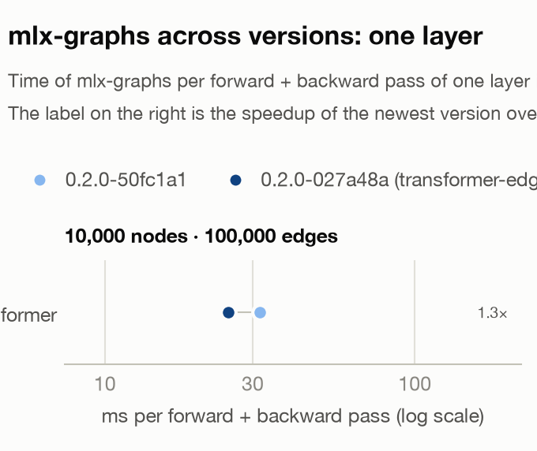

# mlx-graphs across versions

Benchmark results of every version of mlx-graphs measured on this machine (Apple M1, 8 GB), oldest first. Each version is a directory next to this file, with its own `results.md`. Regenerate with `python benchmarks/pyg_comparison/history.py`.

| version | branch | library commit | date | mlx | torch / PyG |
|---|---|---|---|---|---|
| [0.2.0-50fc1a1](0.2.0-50fc1a1/results.md) | – | `50fc1a1` PyG parity: samplers and loaders, heterogeneous, temporal and transformer models, 26 new convolutions, 18 datasets | 2026-11-21 | 0.32.4 | 2.15.0 / 2.5.0 |
| [0.2.0-027a48a](0.2.0-027a48a/results.md) | transformer-edge-scores | `027a48a` TransformerConv: attention scores with mlx_cluster.edge_scores, fused SpMM aggregation | 2026-11-21 | 0.32.4 | 2.15.0 / 2.5.0 |

Speedup columns compare the newest version (0.2.0-027a48a (transformer-edge-scores)) with the oldest (0.2.0-50fc1a1). Times are medians, accuracies are mean ± standard deviation over seeds.

## One layer, forward + backward

<picture>
  <source media="(prefers-color-scheme: dark)" srcset="figures/history_layer_dark.png">
  
</picture>

mlx-graphs time (ms per pass):

| | | 0.2.0-50fc1a1 | 0.2.0-027a48a (transformer-edge-scores) | speedup |
|---|---|---:|---:|---:|
| 10,000 nodes · 100,000 edges | Transformer | 31.59 | 24.97 | 1.3× |

Peak memory (GB) of mlx-graphs:

| | | 0.2.0-50fc1a1 | 0.2.0-027a48a (transformer-edge-scores) |
|---|---|---:|---:|
| 10,000 nodes · 100,000 edges | Transformer | 0.61 | 0.21 |
