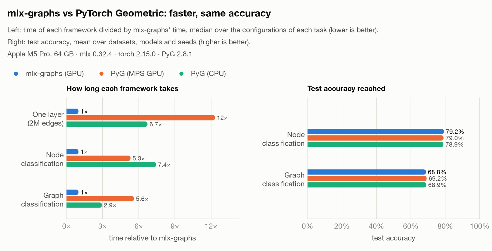
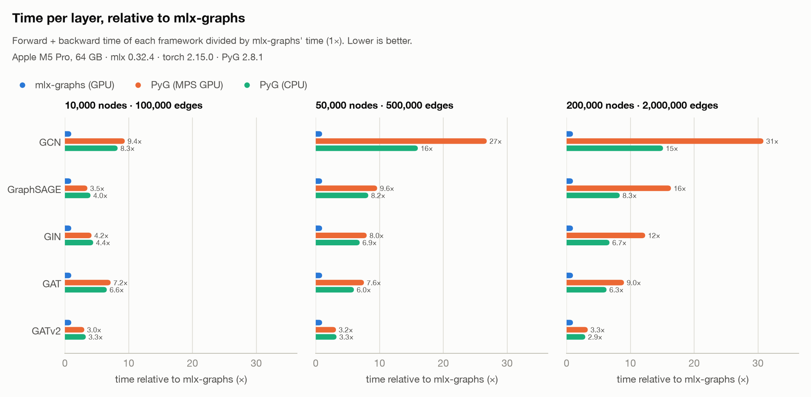
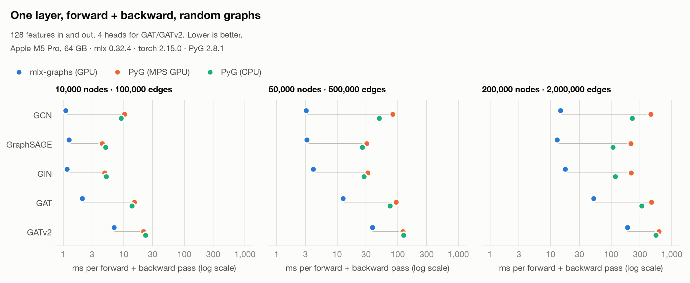
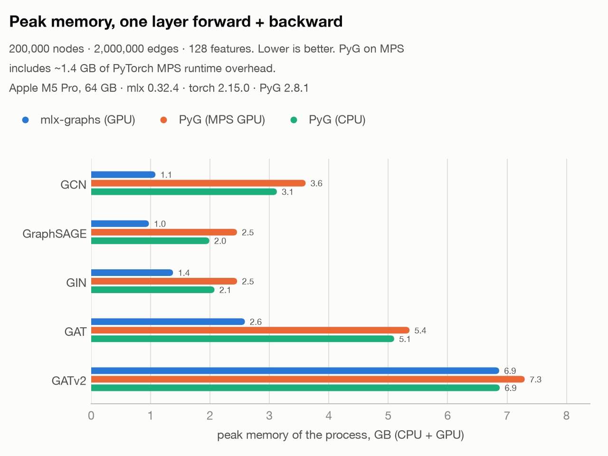
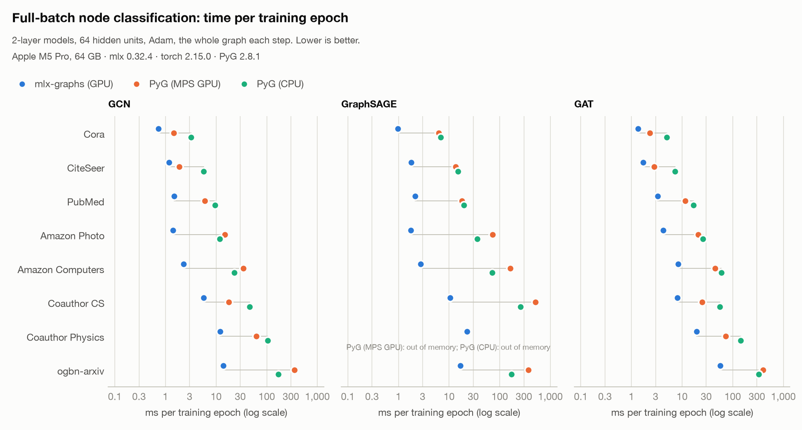
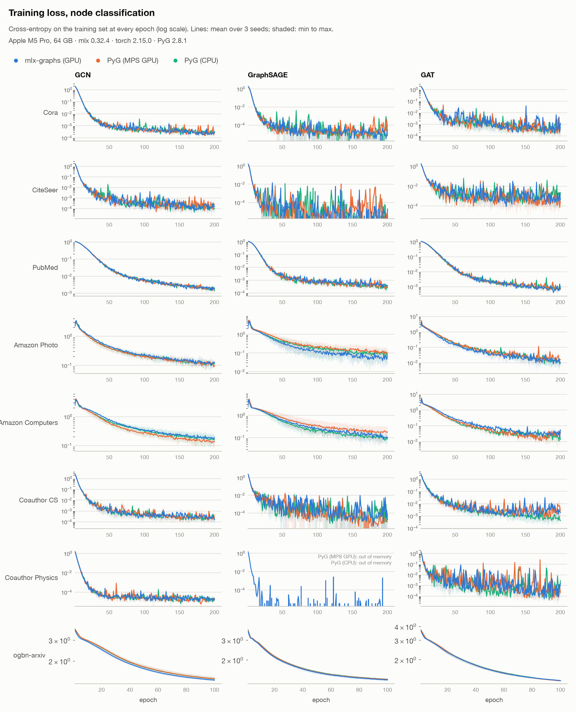
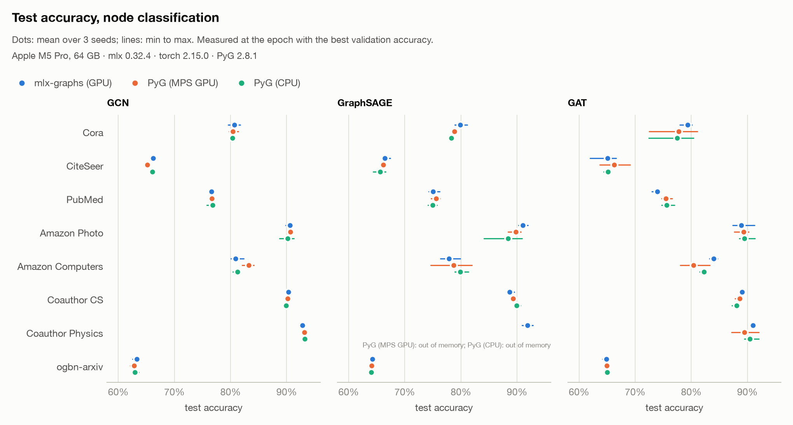
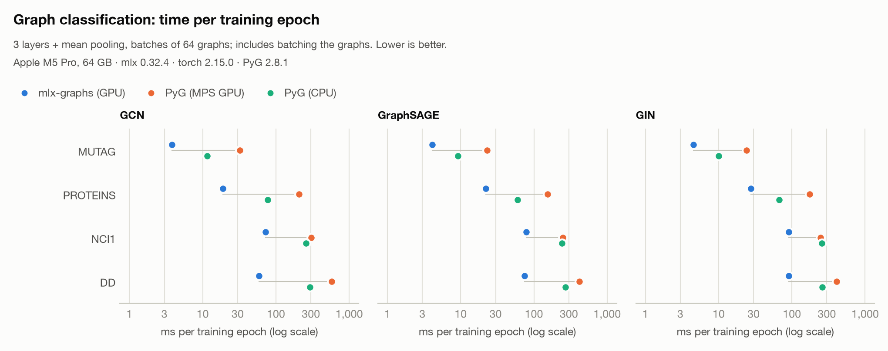
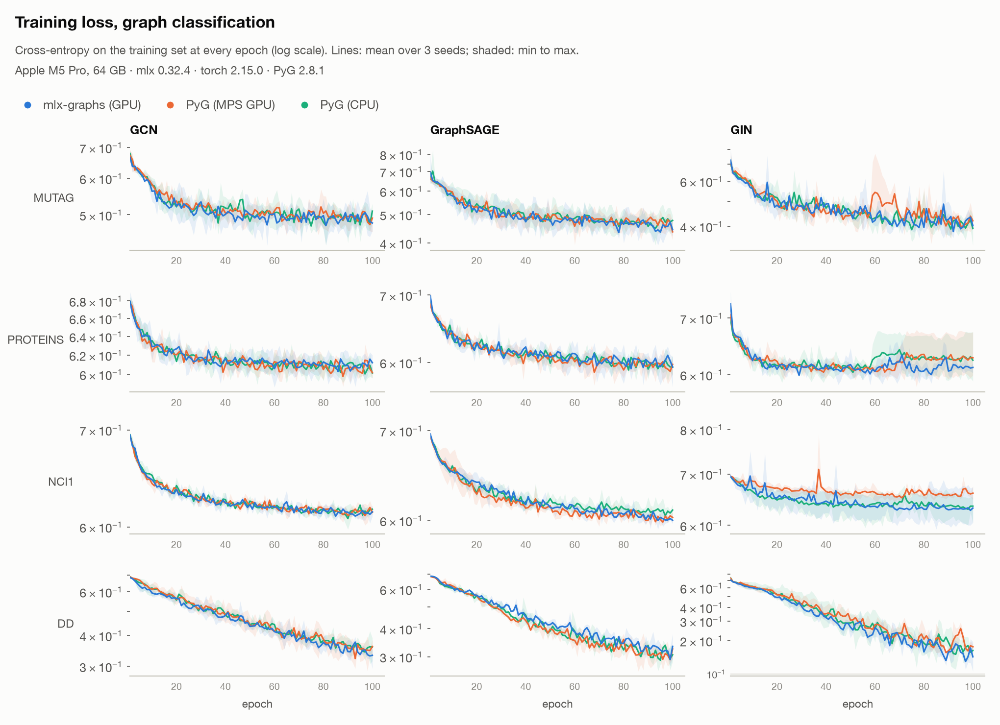
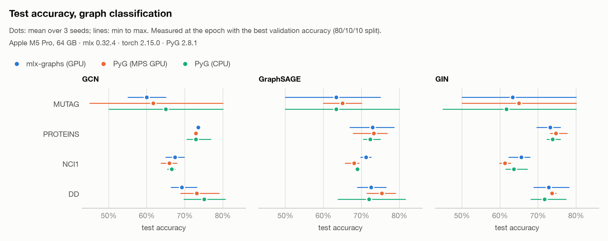

# mlx-graphs vs PyTorch Geometric

Machine: Apple M5 Pro, 64 GB, macOS 27.2.1. mlx 0.32.4, mlx-graphs 0.0.10, mlx-cluster 0.1.2, torch 2.15.0, torch_geometric 2.8.1, Python 3.12.14.

Times are medians in milliseconds; lower is better. Speedup is the PyG time divided by the mlx-graphs time.

mlx-graphs trains GNNs **5.6× faster than PyG on the Mac's GPU (MPS)** and **5.8× faster than PyG on the CPU** (median over 35 training benchmarks, up to 58×), and reaches the same accuracy.

<picture>
  <source media="(prefers-color-scheme: dark)" srcset="figures/headline_dark.png">
  
</picture>

## One layer, forward + backward

Random graphs, 128 input and output features, 4 heads for GAT/GATv2.

<picture>
  <source media="(prefers-color-scheme: dark)" srcset="figures/layers_speedup_dark.png">
  
</picture>

<picture>
  <source media="(prefers-color-scheme: dark)" srcset="figures/layers_time_dark.png">
  
</picture>

<picture>
  <source media="(prefers-color-scheme: dark)" srcset="figures/layers_memory_dark.png">
  
</picture>

| graph | layer | mlx-graphs | PyG MPS | PyG CPU | speedup vs MPS | speedup vs CPU | peak GB mlx / MPS / CPU |
|---|---|---:|---:|---:|---:|---:|---|
| 10,000 nodes, 100,000 edges | GCN | 1.10 | 10.29 | 9.06 | 9.4× | 8.3× | 0.1 / 1.4 / 0.4 |
| 10,000 nodes, 100,000 edges | GraphSAGE | 1.26 | 4.43 | 5.04 | 3.5× | 4.0× | 0.1 / 1.4 / 0.4 |
| 10,000 nodes, 100,000 edges | GIN | 1.16 | 4.84 | 5.15 | 4.2× | 4.4× | 0.2 / 1.4 / 0.4 |
| 10,000 nodes, 100,000 edges | GAT | 2.08 | 14.89 | 13.65 | 7.2× | 6.6× | 0.2 / 1.4 / 0.5 |
| 10,000 nodes, 100,000 edges | GATv2 | 6.95 | 21.16 | 22.77 | 3.0× | 3.3× | 0.6 / 1.4 / 0.6 |
| 50,000 nodes, 500,000 edges | GCN | 3.08 | 82.67 | 49.36 | 26.8× | 16.0× | 0.3 / 1.4 / 1.0 |
| 50,000 nodes, 500,000 edges | GraphSAGE | 3.17 | 30.54 | 26.13 | 9.6× | 8.2× | 0.3 / 1.4 / 0.7 |
| 50,000 nodes, 500,000 edges | GIN | 4.01 | 32.03 | 27.62 | 8.0× | 6.9× | 0.4 / 1.4 / 0.7 |
| 50,000 nodes, 500,000 edges | GAT | 12.41 | 93.77 | 74.24 | 7.6× | 6.0× | 0.8 / 2.4 / 1.5 |
| 50,000 nodes, 500,000 edges | GATv2 | 38.42 | 121.88 | 125.18 | 3.2× | 3.3× | 2.3 / 2.4 / 1.9 |
| 200,000 nodes, 2,000,000 edges | GCN | 14.67 | 452.47 | 221.73 | 30.8× | 15.1× | 1.1 / 3.6 / 3.1 |
| 200,000 nodes, 2,000,000 edges | GraphSAGE | 12.89 | 210.92 | 107.43 | 16.4× | 8.3× | 1.0 / 2.5 / 2.0 |
| 200,000 nodes, 2,000,000 edges | GIN | 17.44 | 214.91 | 117.30 | 12.3× | 6.7× | 1.4 / 2.5 / 2.1 |
| 200,000 nodes, 2,000,000 edges | GAT | 51.16 | 460.24 | 320.36 | 9.0× | 6.3× | 2.6 / 5.4 / 5.1 |
| 200,000 nodes, 2,000,000 edges | GATv2 | 185.66 | 616.58 | 543.94 | 3.3× | 2.9× | 6.9 / 7.3 / 6.9 |

## Full-batch node classification

Median time per training epoch over 3 seeds.

<picture>
  <source media="(prefers-color-scheme: dark)" srcset="figures/node_classification_dark.png">
  
</picture>

| dataset | model | mlx-graphs | PyG MPS | PyG CPU | speedup vs MPS | speedup vs CPU |
|---|---|---:|---:|---:|---:|---:|
| Cora | GCN | 0.73 | 1.45 | 3.19 | 2.0× | 4.4× |
| Cora | GraphSAGE | 0.97 | 6.20 | 6.77 | 6.4× | 7.0× |
| Cora | GAT | 1.36 | 2.31 | 4.98 | 1.7× | 3.7× |
| CiteSeer | GCN | 1.17 | 1.88 | 5.68 | 1.6× | 4.9× |
| CiteSeer | GraphSAGE | 1.80 | 13.38 | 15.06 | 7.5× | 8.4× |
| CiteSeer | GAT | 1.70 | 2.79 | 7.26 | 1.6× | 4.3× |
| PubMed | GCN | 1.49 | 5.98 | 9.56 | 4.0× | 6.4× |
| PubMed | GraphSAGE | 2.13 | 18.02 | 19.59 | 8.5× | 9.2× |
| PubMed | GAT | 3.32 | 11.46 | 16.76 | 3.5× | 5.0× |
| Amazon Photo | GCN | 1.40 | 15.01 | 11.81 | 10.7× | 8.4× |
| Amazon Photo | GraphSAGE | 1.75 | 72.05 | 35.96 | 41.2× | 20.6× |
| Amazon Photo | GAT | 4.27 | 20.93 | 25.59 | 4.9× | 6.0× |
| Amazon Computers | GCN | 2.29 | 34.56 | 22.82 | 15.1× | 10.0× |
| Amazon Computers | GraphSAGE | 2.76 | 160.60 | 70.52 | 58.1× | 25.5× |
| Amazon Computers | GAT | 8.43 | 44.84 | 59.60 | 5.3× | 7.1× |
| Coauthor CS | GCN | 5.67 | 17.77 | 45.99 | 3.1× | 8.1× |
| Coauthor CS | GraphSAGE | 10.49 | 504.98 | 257.72 | 48.1× | 24.6× |
| Coauthor CS | GAT | 8.01 | 24.73 | 55.87 | 3.1× | 7.0× |
| Coauthor Physics | GCN | 12.10 | 62.05 | 104.75 | 5.1× | 8.7× |
| Coauthor Physics | GraphSAGE | 22.57 | out of memory | out of memory | – | – |
| Coauthor Physics | GAT | 19.29 | 72.29 | 143.31 | 3.7× | 7.4× |
| ogbn-arxiv | GCN | 13.90 | 353.54 | 168.30 | 25.4× | 12.1× |
| ogbn-arxiv | GraphSAGE | 16.61 | 364.71 | 169.94 | 22.0× | 10.2× |
| ogbn-arxiv | GAT | 56.12 | 395.49 | 325.32 | 7.0× | 5.8× |

### Full-batch node classification: training quality

Do the models train the same in both frameworks? Training loss at every epoch, and test accuracy at the epoch with the best validation accuracy on the dataset's validation split, mean ± standard deviation over 3 seeds. Final loss is the mean training loss over the last 10 epochs.

<picture>
  <source media="(prefers-color-scheme: dark)" srcset="figures/node_loss_dark.png">
  
</picture>

<picture>
  <source media="(prefers-color-scheme: dark)" srcset="figures/node_accuracy_dark.png">
  
</picture>

| dataset | model | test acc. mlx-graphs | PyG MPS | PyG CPU | final loss mlx-graphs | PyG MPS | PyG CPU |
|---|---|---:|---:|---:|---:|---:|---:|
| Cora | GCN | 0.807 ± 0.009 | 0.804 ± 0.007 | 0.804 ± 0.003 | 0.000 | 0.000 | 0.000 |
| Cora | GraphSAGE | 0.799 ± 0.009 | 0.789 ± 0.000 | 0.783 ± 0.003 | 0.000 | 0.000 | 0.000 |
| Cora | GAT | 0.793 ± 0.009 | 0.778 ± 0.038 | 0.775 ± 0.036 | 0.001 | 0.001 | 0.001 |
| CiteSeer | GCN | 0.662 ± 0.002 | 0.652 ± 0.002 | 0.661 ± 0.004 | 0.000 | 0.000 | 0.000 |
| CiteSeer | GraphSAGE | 0.664 ± 0.007 | 0.662 ± 0.004 | 0.656 ± 0.009 | 0.000 | 0.000 | 0.000 |
| CiteSeer | GAT | 0.651 ± 0.022 | 0.663 ± 0.022 | 0.651 ± 0.005 | 0.001 | 0.001 | 0.003 |
| PubMed | GCN | 0.766 ± 0.002 | 0.767 ± 0.002 | 0.768 ± 0.007 | 0.002 | 0.002 | 0.002 |
| PubMed | GraphSAGE | 0.750 ± 0.008 | 0.756 ± 0.007 | 0.749 ± 0.007 | 0.000 | 0.000 | 0.000 |
| PubMed | GAT | 0.739 ± 0.007 | 0.755 ± 0.008 | 0.756 ± 0.010 | 0.001 | 0.001 | 0.001 |
| Amazon Photo | GCN | 0.906 ± 0.006 | 0.907 ± 0.005 | 0.901 ± 0.011 | 0.121 | 0.113 | 0.114 |
| Amazon Photo | GraphSAGE | 0.911 ± 0.007 | 0.898 ± 0.010 | 0.884 ± 0.031 | 0.057 | 0.106 | 0.093 |
| Amazon Photo | GAT | 0.889 ± 0.017 | 0.893 ± 0.012 | 0.895 ± 0.013 | 0.014 | 0.019 | 0.013 |
| Amazon Computers | GCN | 0.809 ± 0.011 | 0.833 ± 0.009 | 0.813 ± 0.006 | 0.184 | 0.137 | 0.166 |
| Amazon Computers | GraphSAGE | 0.778 ± 0.015 | 0.787 ± 0.031 | 0.799 ± 0.010 | 0.105 | 0.184 | 0.098 |
| Amazon Computers | GAT | 0.840 ± 0.006 | 0.804 ± 0.022 | 0.823 ± 0.006 | 0.037 | 0.030 | 0.020 |
| Coauthor CS | GCN | 0.903 ± 0.002 | 0.902 ± 0.005 | 0.899 ± 0.002 | 0.000 | 0.000 | 0.000 |
| Coauthor CS | GraphSAGE | 0.886 ± 0.006 | 0.893 ± 0.004 | 0.900 ± 0.005 | 0.001 | 0.000 | 0.000 |
| Coauthor CS | GAT | 0.890 ± 0.004 | 0.886 ± 0.006 | 0.881 ± 0.006 | 0.003 | 0.005 | 0.001 |
| Coauthor Physics | GCN | 0.928 ± 0.005 | 0.931 ± 0.000 | 0.932 ± 0.001 | 0.000 | 0.000 | 0.000 |
| Coauthor Physics | GraphSAGE | 0.919 ± 0.008 | out of memory | out of memory | 0.000 | out of memory | out of memory |
| Coauthor Physics | GAT | 0.910 ± 0.003 | 0.894 ± 0.020 | 0.905 ± 0.011 | 0.001 | 0.000 | 0.002 |
| ogbn-arxiv | GCN | 0.633 ± 0.006 | 0.628 ± 0.005 | 0.630 ± 0.005 | 1.396 | 1.437 | 1.434 |
| ogbn-arxiv | GraphSAGE | 0.642 ± 0.004 | 0.641 ± 0.003 | 0.640 ± 0.004 | 1.341 | 1.355 | 1.361 |
| ogbn-arxiv | GAT | 0.649 ± 0.005 | 0.650 ± 0.001 | 0.650 ± 0.001 | 1.314 | 1.308 | 1.314 |

## Graph classification

Median time per training epoch over 3 seeds.

<picture>
  <source media="(prefers-color-scheme: dark)" srcset="figures/graph_classification_dark.png">
  
</picture>

| dataset | model | mlx-graphs | PyG MPS | PyG CPU | speedup vs MPS | speedup vs CPU |
|---|---|---:|---:|---:|---:|---:|
| MUTAG | GCN | 3.79 | 32.03 | 11.46 | 8.5× | 3.0× |
| MUTAG | GraphSAGE | 4.08 | 22.87 | 9.21 | 5.6× | 2.3× |
| MUTAG | GIN | 4.50 | 24.13 | 10.04 | 5.4× | 2.2× |
| PROTEINS | GCN | 18.79 | 206.44 | 77.09 | 11.0× | 4.1× |
| PROTEINS | GraphSAGE | 22.14 | 154.22 | 60.22 | 7.0× | 2.7× |
| PROTEINS | GIN | 27.44 | 174.14 | 66.76 | 6.3× | 2.4× |
| NCI1 | GCN | 72.14 | 301.91 | 257.72 | 4.2× | 3.6× |
| NCI1 | GraphSAGE | 78.88 | 247.87 | 240.89 | 3.1× | 3.1× |
| NCI1 | GIN | 91.16 | 245.39 | 256.02 | 2.7× | 2.8× |
| DD | GCN | 59.10 | 579.26 | 292.56 | 9.8× | 4.9× |
| DD | GraphSAGE | 74.88 | 418.12 | 270.60 | 5.6× | 3.6× |
| DD | GIN | 91.09 | 407.19 | 259.07 | 4.5× | 2.8× |

### Graph classification: training quality

Do the models train the same in both frameworks? Training loss at every epoch, and test accuracy at the epoch with the best validation accuracy on a random 80/10/10 train/validation/test split, mean ± standard deviation over 3 seeds. Final loss is the mean training loss over the last 10 epochs.

<picture>
  <source media="(prefers-color-scheme: dark)" srcset="figures/graph_loss_dark.png">
  
</picture>

<picture>
  <source media="(prefers-color-scheme: dark)" srcset="figures/graph_accuracy_dark.png">
  
</picture>

| dataset | model | test acc. mlx-graphs | PyG MPS | PyG CPU | final loss mlx-graphs | PyG MPS | PyG CPU |
|---|---|---:|---:|---:|---:|---:|---:|
| MUTAG | GCN | 0.600 ± 0.041 | 0.617 ± 0.143 | 0.650 ± 0.122 | 0.494 | 0.493 | 0.491 |
| MUTAG | GraphSAGE | 0.633 ± 0.103 | 0.650 ± 0.041 | 0.633 ± 0.125 | 0.452 | 0.469 | 0.470 |
| MUTAG | GIN | 0.633 ± 0.125 | 0.650 ± 0.122 | 0.617 ± 0.143 | 0.413 | 0.418 | 0.408 |
| PROTEINS | GCN | 0.735 ± 0.004 | 0.729 ± 0.004 | 0.729 ± 0.028 | 0.609 | 0.606 | 0.607 |
| PROTEINS | GraphSAGE | 0.729 ± 0.047 | 0.732 ± 0.039 | 0.723 ± 0.019 | 0.600 | 0.596 | 0.596 |
| PROTEINS | GIN | 0.732 ± 0.026 | 0.747 ± 0.021 | 0.738 ± 0.015 | 0.612 | 0.627 | 0.626 |
| NCI1 | GCN | 0.674 ± 0.020 | 0.659 ± 0.017 | 0.666 ± 0.008 | 0.613 | 0.615 | 0.615 |
| NCI1 | GraphSAGE | 0.712 ± 0.011 | 0.680 ± 0.017 | 0.689 ± 0.005 | 0.602 | 0.603 | 0.609 |
| NCI1 | GIN | 0.656 ± 0.024 | 0.613 ± 0.012 | 0.637 ± 0.025 | 0.630 | 0.660 | 0.634 |
| DD | GCN | 0.692 ± 0.029 | 0.731 ± 0.043 | 0.751 ± 0.045 | 0.345 | 0.352 | 0.358 |
| DD | GraphSAGE | 0.725 ± 0.031 | 0.754 ± 0.031 | 0.720 ± 0.073 | 0.323 | 0.306 | 0.307 |
| DD | GIN | 0.728 ± 0.039 | 0.737 ± 0.008 | 0.717 ± 0.040 | 0.159 | 0.198 | 0.167 |
