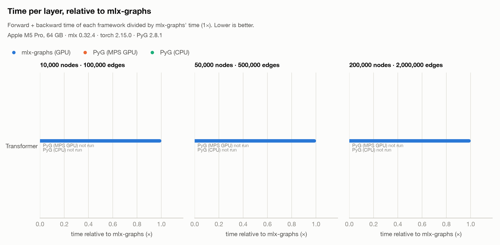
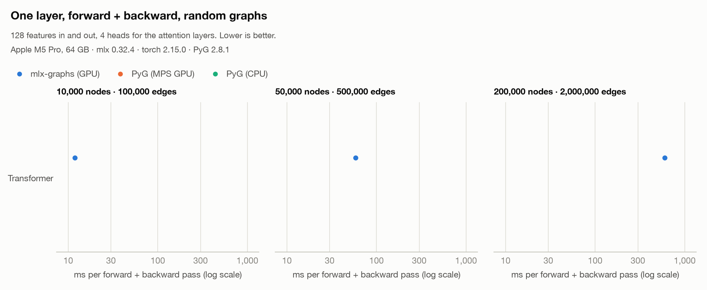
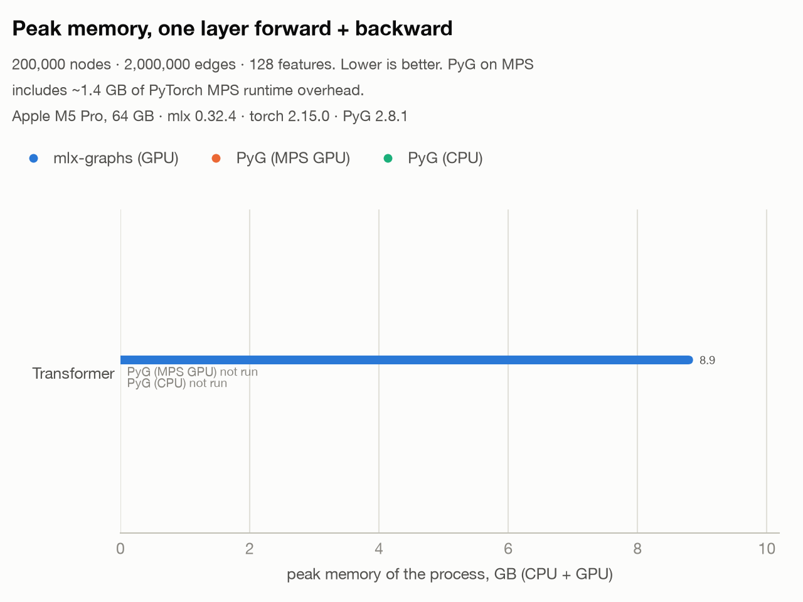

# mlx-graphs vs PyTorch Geometric

Machine: Apple M5 Pro, 64 GB, macOS 27.2.1. mlx 0.32.4, mlx-graphs 0.2.0, mlx-cluster 0.1.2, torch 2.15.0, torch_geometric 2.8.1, Python 3.12.14.

Times are medians in milliseconds; lower is better. Speedup is the PyG time divided by the mlx-graphs time.

## One layer, forward + backward

Random graphs, 128 input and output features, 4 heads for the attention layers.

<picture>
  <source media="(prefers-color-scheme: dark)" srcset="figures/layers_speedup_dark.png">
  
</picture>

<picture>
  <source media="(prefers-color-scheme: dark)" srcset="figures/layers_time_dark.png">
  
</picture>

<picture>
  <source media="(prefers-color-scheme: dark)" srcset="figures/layers_memory_dark.png">
  
</picture>

| graph | layer | mlx-graphs | PyG MPS | PyG CPU | speedup vs MPS | speedup vs CPU | peak GB mlx / MPS / CPU |
|---|---|---:|---:|---:|---:|---:|---|
| 10,000 nodes, 100,000 edges | Transformer | 11.87 | – | – | – | – | 0.7 / – / – |
| 50,000 nodes, 500,000 edges | Transformer | 58.49 | – | – | – | – | 2.8 / – / – |
| 200,000 nodes, 2,000,000 edges | Transformer | 596.08 | – | – | – | – | 8.9 / – / – |
