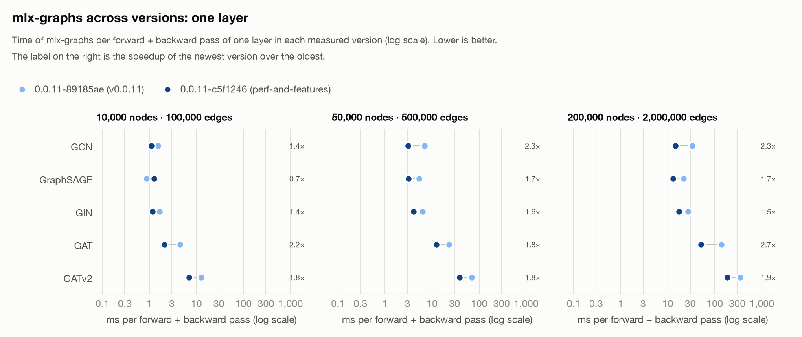
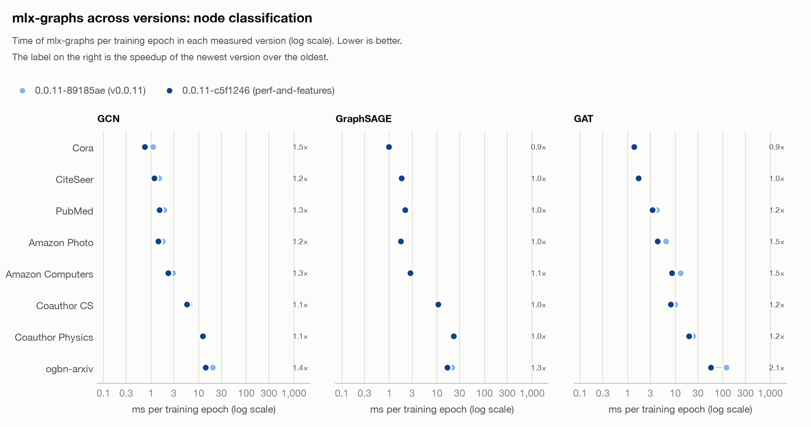
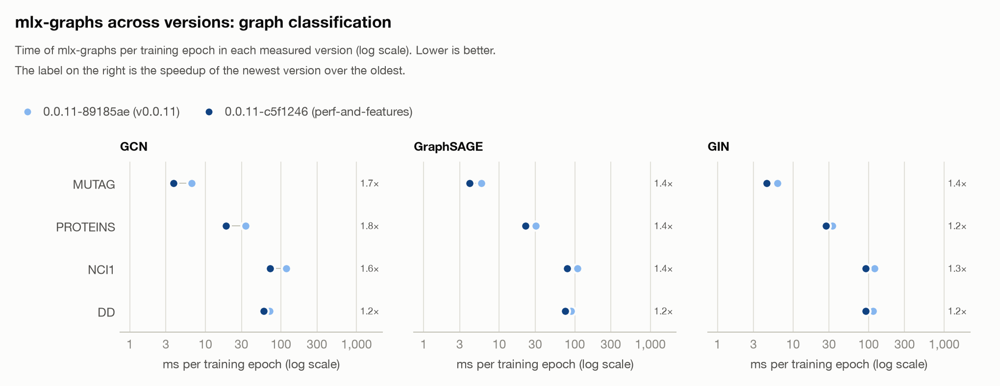

# mlx-graphs across versions

Benchmark results of every version of mlx-graphs measured on this machine (Apple M5 Pro, 64 GB), oldest first. Each version is a directory next to this file, with its own `results.md`. Regenerate with `python benchmarks/pyg_comparison/history.py`.

| version | branch | library commit | date | mlx | torch / PyG |
|---|---|---|---|---|---|
| [0.0.11-89185ae](0.0.11-89185ae/results.md) | v0.0.11 | `89185ae` Node2 vec bug fix (#201) | 2026-11-20 | 0.32.4 | 2.15.0 / 2.8.1 |
| [0.0.11-c5f1246](0.0.11-c5f1246/results.md) | perf-and-features | `c5f1246` Faster message passing, PyG-parity layers and models, PyG benchmarks | 2026-11-20 | 0.32.4 | 2.15.0 / 2.8.1 |

Speedup columns compare the newest version (0.0.11-c5f1246 (perf-and-features)) with the oldest (0.0.11-89185ae (v0.0.11)). Times are medians, accuracies are mean ± standard deviation over seeds.

## One layer, forward + backward

<picture>
  <source media="(prefers-color-scheme: dark)" srcset="figures/history_layer_dark.png">
  
</picture>

mlx-graphs time (ms per pass):

| | | 0.0.11-89185ae (v0.0.11) | 0.0.11-c5f1246 (perf-and-features) | speedup |
|---|---|---:|---:|---:|
| 10,000 nodes · 100,000 edges | GCN | 1.53 | 1.10 | 1.4× |
| 10,000 nodes · 100,000 edges | GraphSAGE | 0.88 | 1.26 | 0.7× |
| 10,000 nodes · 100,000 edges | GIN | 1.63 | 1.16 | 1.4× |
| 10,000 nodes · 100,000 edges | GAT | 4.50 | 2.08 | 2.2× |
| 10,000 nodes · 100,000 edges | GATv2 | 12.74 | 6.95 | 1.8× |
| 50,000 nodes · 500,000 edges | GCN | 6.97 | 3.08 | 2.3× |
| 50,000 nodes · 500,000 edges | GraphSAGE | 5.31 | 3.17 | 1.7× |
| 50,000 nodes · 500,000 edges | GIN | 6.23 | 4.01 | 1.6× |
| 50,000 nodes · 500,000 edges | GAT | 22.87 | 12.41 | 1.8× |
| 50,000 nodes · 500,000 edges | GATv2 | 69.74 | 38.42 | 1.8× |
| 200,000 nodes · 2,000,000 edges | GCN | 33.29 | 14.67 | 2.3× |
| 200,000 nodes · 2,000,000 edges | GraphSAGE | 21.93 | 12.89 | 1.7× |
| 200,000 nodes · 2,000,000 edges | GIN | 26.99 | 17.44 | 1.5× |
| 200,000 nodes · 2,000,000 edges | GAT | 138.34 | 51.16 | 2.7× |
| 200,000 nodes · 2,000,000 edges | GATv2 | 350.40 | 185.66 | 1.9× |

Peak memory (GB) of mlx-graphs:

| | | 0.0.11-89185ae (v0.0.11) | 0.0.11-c5f1246 (perf-and-features) |
|---|---|---:|---:|
| 10,000 nodes · 100,000 edges | GCN | 0.14 | 0.15 |
| 10,000 nodes · 100,000 edges | GraphSAGE | 0.14 | 0.14 |
| 10,000 nodes · 100,000 edges | GIN | 0.16 | 0.16 |
| 10,000 nodes · 100,000 edges | GAT | 0.43 | 0.25 |
| 10,000 nodes · 100,000 edges | GATv2 | 0.87 | 0.61 |
| 50,000 nodes · 500,000 edges | GCN | 0.30 | 0.34 |
| 50,000 nodes · 500,000 edges | GraphSAGE | 0.29 | 0.32 |
| 50,000 nodes · 500,000 edges | GIN | 0.40 | 0.42 |
| 50,000 nodes · 500,000 edges | GAT | 1.77 | 0.84 |
| 50,000 nodes · 500,000 edges | GATv2 | 2.90 | 2.32 |
| 200,000 nodes · 2,000,000 edges | GCN | 0.92 | 1.08 |
| 200,000 nodes · 2,000,000 edges | GraphSAGE | 0.87 | 0.97 |
| 200,000 nodes · 2,000,000 edges | GIN | 1.28 | 1.38 |
| 200,000 nodes · 2,000,000 edges | GAT | 6.70 | 2.59 |
| 200,000 nodes · 2,000,000 edges | GATv2 | 10.31 | 6.87 |

## Full-batch node classification

<picture>
  <source media="(prefers-color-scheme: dark)" srcset="figures/history_node_dark.png">
  
</picture>

mlx-graphs time (ms per epoch):

| | | 0.0.11-89185ae (v0.0.11) | 0.0.11-c5f1246 (perf-and-features) | speedup |
|---|---|---:|---:|---:|
| GCN | Cora | 1.10 | 0.73 | 1.5× |
| GCN | CiteSeer | 1.46 | 1.17 | 1.2× |
| GCN | PubMed | 1.87 | 1.49 | 1.3× |
| GCN | Amazon Photo | 1.74 | 1.40 | 1.2× |
| GCN | Amazon Computers | 2.88 | 2.29 | 1.3× |
| GCN | Coauthor CS | 6.34 | 5.67 | 1.1× |
| GCN | Coauthor Physics | 13.19 | 12.10 | 1.1× |
| GCN | ogbn-arxiv | 19.79 | 13.90 | 1.4× |
| GraphSAGE | Cora | 0.91 | 0.97 | 0.9× |
| GraphSAGE | CiteSeer | 1.84 | 1.80 | 1.0× |
| GraphSAGE | PubMed | 2.13 | 2.13 | 1.0× |
| GraphSAGE | Amazon Photo | 1.76 | 1.75 | 1.0× |
| GraphSAGE | Amazon Computers | 2.91 | 2.76 | 1.1× |
| GraphSAGE | Coauthor CS | 10.61 | 10.49 | 1.0× |
| GraphSAGE | Coauthor Physics | 23.21 | 22.57 | 1.0× |
| GraphSAGE | ogbn-arxiv | 20.92 | 16.61 | 1.3× |
| GAT | Cora | 1.27 | 1.36 | 0.9× |
| GAT | CiteSeer | 1.78 | 1.70 | 1.0× |
| GAT | PubMed | 4.10 | 3.32 | 1.2× |
| GAT | Amazon Photo | 6.33 | 4.27 | 1.5× |
| GAT | Amazon Computers | 13.01 | 8.43 | 1.5× |
| GAT | Coauthor CS | 9.99 | 8.01 | 1.2× |
| GAT | Coauthor Physics | 23.64 | 19.29 | 1.2× |
| GAT | ogbn-arxiv | 118.24 | 56.12 | 2.1× |

Test accuracy of mlx-graphs:

| | | 0.0.11-89185ae (v0.0.11) | 0.0.11-c5f1246 (perf-and-features) |
|---|---|---:|---:|
| GCN | Cora | 0.804 ± 0.011 | 0.807 ± 0.009 |
| GCN | CiteSeer | 0.674 ± 0.003 | 0.662 ± 0.002 |
| GCN | PubMed | 0.765 ± 0.002 | 0.766 ± 0.002 |
| GCN | Amazon Photo | 0.907 ± 0.008 | 0.906 ± 0.006 |
| GCN | Amazon Computers | 0.818 ± 0.012 | 0.809 ± 0.011 |
| GCN | Coauthor CS | 0.903 ± 0.006 | 0.903 ± 0.002 |
| GCN | Coauthor Physics | 0.925 ± 0.004 | 0.928 ± 0.005 |
| GCN | ogbn-arxiv | 0.625 ± 0.005 | 0.633 ± 0.006 |
| GraphSAGE | Cora | 0.784 ± 0.006 | 0.799 ± 0.009 |
| GraphSAGE | CiteSeer | 0.665 ± 0.004 | 0.664 ± 0.007 |
| GraphSAGE | PubMed | 0.749 ± 0.004 | 0.750 ± 0.008 |
| GraphSAGE | Amazon Photo | 0.722 ± 0.084 | 0.911 ± 0.007 |
| GraphSAGE | Amazon Computers | 0.630 ± 0.026 | 0.778 ± 0.015 |
| GraphSAGE | Coauthor CS | 0.893 ± 0.003 | 0.886 ± 0.006 |
| GraphSAGE | Coauthor Physics | 0.923 ± 0.005 | 0.919 ± 0.008 |
| GraphSAGE | ogbn-arxiv | 0.649 ± 0.003 | 0.642 ± 0.004 |
| GAT | Cora | 0.795 ± 0.013 | 0.793 ± 0.009 |
| GAT | CiteSeer | 0.653 ± 0.014 | 0.651 ± 0.022 |
| GAT | PubMed | 0.738 ± 0.007 | 0.739 ± 0.007 |
| GAT | Amazon Photo | 0.894 ± 0.017 | 0.889 ± 0.017 |
| GAT | Amazon Computers | 0.844 ± 0.007 | 0.840 ± 0.006 |
| GAT | Coauthor CS | 0.889 ± 0.003 | 0.890 ± 0.004 |
| GAT | Coauthor Physics | 0.910 ± 0.004 | 0.910 ± 0.003 |
| GAT | ogbn-arxiv | 0.648 ± 0.005 | 0.649 ± 0.005 |

## Graph classification

<picture>
  <source media="(prefers-color-scheme: dark)" srcset="figures/history_graph_dark.png">
  
</picture>

mlx-graphs time (ms per epoch):

| | | 0.0.11-89185ae (v0.0.11) | 0.0.11-c5f1246 (perf-and-features) | speedup |
|---|---|---:|---:|---:|
| GCN | MUTAG | 6.59 | 3.79 | 1.7× |
| GCN | PROTEINS | 33.90 | 18.79 | 1.8× |
| GCN | NCI1 | 118.20 | 72.14 | 1.6× |
| GCN | DD | 71.31 | 59.10 | 1.2× |
| GraphSAGE | MUTAG | 5.79 | 4.08 | 1.4× |
| GraphSAGE | PROTEINS | 30.70 | 22.14 | 1.4× |
| GraphSAGE | NCI1 | 108.89 | 78.88 | 1.4× |
| GraphSAGE | DD | 89.75 | 74.88 | 1.2× |
| GIN | MUTAG | 6.22 | 4.50 | 1.4× |
| GIN | PROTEINS | 33.05 | 27.44 | 1.2× |
| GIN | NCI1 | 120.30 | 91.16 | 1.3× |
| GIN | DD | 113.81 | 91.09 | 1.2× |

Test accuracy of mlx-graphs:

| | | 0.0.11-89185ae (v0.0.11) | 0.0.11-c5f1246 (perf-and-features) |
|---|---|---:|---:|
| GCN | MUTAG | 0.633 ± 0.143 | 0.600 ± 0.041 |
| GCN | PROTEINS | 0.720 ± 0.021 | 0.735 ± 0.004 |
| GCN | NCI1 | 0.678 ± 0.004 | 0.674 ± 0.020 |
| GCN | DD | 0.695 ± 0.024 | 0.692 ± 0.029 |
| GraphSAGE | MUTAG | 0.617 ± 0.143 | 0.633 ± 0.103 |
| GraphSAGE | PROTEINS | 0.729 ± 0.017 | 0.729 ± 0.047 |
| GraphSAGE | NCI1 | 0.699 ± 0.013 | 0.712 ± 0.011 |
| GraphSAGE | DD | 0.734 ± 0.034 | 0.725 ± 0.031 |
| GIN | MUTAG | 0.700 ± 0.108 | 0.633 ± 0.125 |
| GIN | PROTEINS | 0.732 ± 0.032 | 0.732 ± 0.026 |
| GIN | NCI1 | 0.667 ± 0.011 | 0.656 ± 0.024 |
| GIN | DD | 0.723 ± 0.079 | 0.728 ± 0.039 |
