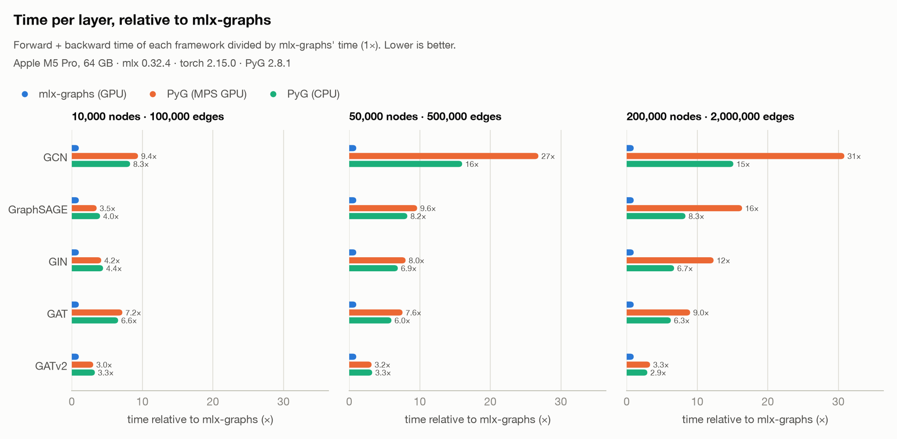
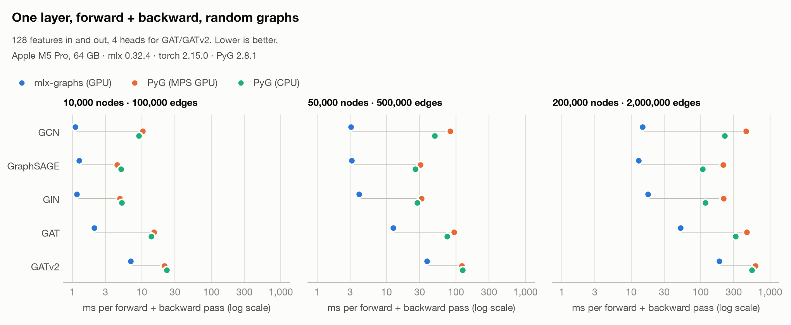
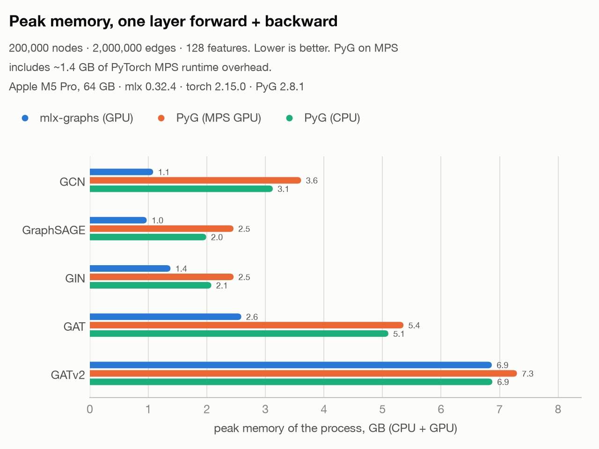
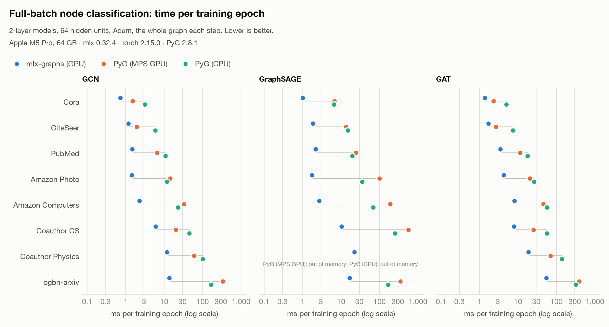
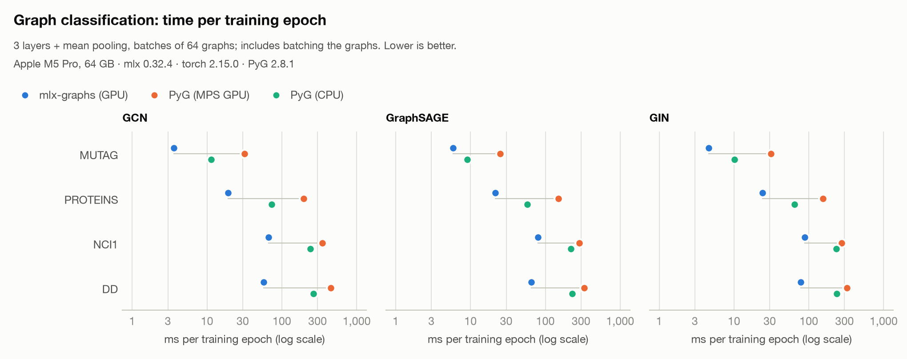

# mlx-graphs vs PyTorch Geometric

Machine: Apple M5 Pro, 64 GB, macOS 27.2.1. mlx 0.32.4, mlx-graphs 0.0.10, mlx-cluster 0.1.2, torch 2.15.0, torch_geometric 2.8.1, Python 3.12.14.

Times are medians in milliseconds; lower is better. Speedup is the PyG time divided by the mlx-graphs time.

## One layer, forward + backward

Random graphs, 128 input and output features, 4 heads for GAT/GATv2.

<picture>
  <source media="(prefers-color-scheme: dark)" srcset="figures/layers_speedup_dark.png">
  
</picture>

<picture>
  <source media="(prefers-color-scheme: dark)" srcset="figures/layers_time_dark.png">
  
</picture>

<picture>
  <source media="(prefers-color-scheme: dark)" srcset="figures/layers_memory_dark.png">
  
</picture>

| graph | layer | mlx-graphs | PyG MPS | PyG CPU | speedup vs MPS | speedup vs CPU | peak GB mlx / MPS / CPU |
|---|---|---:|---:|---:|---:|---:|---|
| 10,000 nodes, 100,000 edges | GCN | 1.10 | 10.29 | 9.06 | 9.4× | 8.3× | 0.1 / 1.4 / 0.4 |
| 10,000 nodes, 100,000 edges | GraphSAGE | 1.26 | 4.43 | 5.04 | 3.5× | 4.0× | 0.1 / 1.4 / 0.4 |
| 10,000 nodes, 100,000 edges | GIN | 1.16 | 4.84 | 5.15 | 4.2× | 4.4× | 0.2 / 1.4 / 0.4 |
| 10,000 nodes, 100,000 edges | GAT | 2.08 | 14.89 | 13.65 | 7.2× | 6.6× | 0.2 / 1.4 / 0.5 |
| 10,000 nodes, 100,000 edges | GATv2 | 6.95 | 21.16 | 22.77 | 3.0× | 3.3× | 0.6 / 1.4 / 0.6 |
| 50,000 nodes, 500,000 edges | GCN | 3.08 | 82.67 | 49.36 | 26.8× | 16.0× | 0.3 / 1.4 / 1.0 |
| 50,000 nodes, 500,000 edges | GraphSAGE | 3.17 | 30.54 | 26.13 | 9.6× | 8.2× | 0.3 / 1.4 / 0.7 |
| 50,000 nodes, 500,000 edges | GIN | 4.01 | 32.03 | 27.62 | 8.0× | 6.9× | 0.4 / 1.4 / 0.7 |
| 50,000 nodes, 500,000 edges | GAT | 12.41 | 93.77 | 74.24 | 7.6× | 6.0× | 0.8 / 2.4 / 1.5 |
| 50,000 nodes, 500,000 edges | GATv2 | 38.42 | 121.88 | 125.18 | 3.2× | 3.3× | 2.3 / 2.4 / 1.9 |
| 200,000 nodes, 2,000,000 edges | GCN | 14.67 | 452.47 | 221.73 | 30.8× | 15.1× | 1.1 / 3.6 / 3.1 |
| 200,000 nodes, 2,000,000 edges | GraphSAGE | 12.89 | 210.92 | 107.43 | 16.4× | 8.3× | 1.0 / 2.5 / 2.0 |
| 200,000 nodes, 2,000,000 edges | GIN | 17.44 | 214.91 | 117.30 | 12.3× | 6.7× | 1.4 / 2.5 / 2.1 |
| 200,000 nodes, 2,000,000 edges | GAT | 51.16 | 460.24 | 320.36 | 9.0× | 6.3× | 2.6 / 5.4 / 5.1 |
| 200,000 nodes, 2,000,000 edges | GATv2 | 185.66 | 616.58 | 543.94 | 3.3× | 2.9× | 6.9 / 7.3 / 6.9 |

## Full-batch node classification

Median time per training epoch. Test accuracy at the best validation epoch.

<picture>
  <source media="(prefers-color-scheme: dark)" srcset="figures/node_classification_dark.png">
  
</picture>

| dataset | model | mlx-graphs | PyG MPS | PyG CPU | speedup vs MPS | speedup vs CPU | accuracy mlx / MPS / CPU |
|---|---|---:|---:|---:|---:|---:|---|
| Cora | GCN | 0.73 | 1.51 | 3.13 | 2.1× | 4.3× | 0.807 / 0.814 / 0.807 |
| Cora | GraphSAGE | 1.00 | 6.71 | 6.62 | 6.7× | 6.6× | 0.796 / 0.789 / 0.784 |
| Cora | GAT | 1.37 | 2.29 | 4.98 | 1.7× | 3.6× | 0.800 / 0.811 / 0.804 |
| CiteSeer | GCN | 1.18 | 1.93 | 5.86 | 1.6× | 5.0× | 0.665 / 0.650 / 0.655 |
| CiteSeer | GraphSAGE | 1.86 | 13.49 | 15.05 | 7.3× | 8.1× | 0.661 / 0.666 / 0.644 |
| CiteSeer | GAT | 1.70 | 2.69 | 7.42 | 1.6× | 4.4× | 0.666 / 0.637 / 0.653 |
| PubMed | GCN | 1.49 | 6.56 | 10.88 | 4.4× | 7.3× | 0.768 / 0.766 / 0.758 |
| PubMed | GraphSAGE | 2.18 | 24.43 | 19.48 | 11.2× | 8.9× | 0.746 / 0.757 / 0.757 |
| PubMed | GAT | 3.50 | 11.33 | 17.80 | 3.2× | 5.1× | 0.746 / 0.766 / 0.770 |
| Amazon Photo | GCN | 1.42 | 14.33 | 11.74 | 10.1× | 8.3× | 0.903 / 0.903 / 0.887 |
| Amazon Photo | GraphSAGE | 1.74 | 100.19 | 35.49 | 57.6× | 20.4× | 0.902 / 0.902 / 0.909 |
| Amazon Photo | GAT | 4.22 | 20.42 | 26.05 | 4.8× | 6.2× | 0.874 / 0.877 / 0.886 |
| Amazon Computers | GCN | 2.26 | 32.65 | 22.75 | 14.5× | 10.1× | 0.802 / 0.842 / 0.816 |
| Amazon Computers | GraphSAGE | 2.71 | 189.23 | 68.47 | 69.9× | 25.3× | 0.798 / 0.820 / 0.789 |
| Amazon Computers | GAT | 8.04 | 45.85 | 56.94 | 5.7× | 7.1× | 0.840 / 0.780 / 0.827 |
| Coauthor CS | GCN | 5.96 | 20.16 | 45.18 | 3.4× | 7.6× | 0.900 / 0.896 / 0.898 |
| Coauthor CS | GraphSAGE | 10.31 | 569.21 | 253.57 | 55.2× | 24.6× | 0.880 / 0.887 / 0.894 |
| Coauthor CS | GAT | 7.94 | 25.41 | 56.91 | 3.2× | 7.2× | 0.889 / 0.878 / 0.872 |
| Coauthor Physics | GCN | 11.86 | 60.46 | 101.44 | 5.1× | 8.6× | 0.933 / 0.931 / 0.933 |
| Coauthor Physics | GraphSAGE | 22.26 | out of memory | out of memory | – | – | 0.909 / out of memory / out of memory |
| Coauthor Physics | GAT | 18.59 | 69.80 | 138.85 | 3.8× | 7.5× | 0.897 / 0.920 / 0.920 |
| ogbn-arxiv | GCN | 13.55 | 336.40 | 164.99 | 24.8× | 12.2× | 0.625 / 0.631 / 0.637 |
| ogbn-arxiv | GraphSAGE | 16.66 | 345.36 | 167.57 | 20.7× | 10.1× | 0.638 / 0.645 / 0.645 |
| ogbn-arxiv | GAT | 55.05 | 387.68 | 321.54 | 7.0× | 5.8× | 0.653 / 0.648 / 0.651 |

## Graph classification

Median time per training epoch. Test accuracy after the last epoch (80/20 random split).

<picture>
  <source media="(prefers-color-scheme: dark)" srcset="figures/graph_classification_dark.png">
  
</picture>

| dataset | model | mlx-graphs | PyG MPS | PyG CPU | speedup vs MPS | speedup vs CPU | accuracy mlx / MPS / CPU |
|---|---|---:|---:|---:|---:|---:|---|
| MUTAG | GCN | 3.59 | 31.65 | 11.29 | 8.8× | 3.1× | 0.632 / 0.658 / 0.763 |
| MUTAG | GraphSAGE | 5.81 | 24.99 | 9.07 | 4.3× | 1.6× | 0.711 / 0.763 / 0.711 |
| MUTAG | GIN | 4.59 | 31.27 | 10.17 | 6.8× | 2.2× | 0.684 / 0.684 / 0.711 |
| PROTEINS | GCN | 19.18 | 194.80 | 72.90 | 10.2× | 3.8× | 0.726 / 0.749 / 0.740 |
| PROTEINS | GraphSAGE | 21.45 | 148.92 | 57.31 | 6.9× | 2.7× | 0.722 / 0.762 / 0.735 |
| PROTEINS | GIN | 24.00 | 155.09 | 63.96 | 6.5× | 2.7× | 0.691 / 0.744 / 0.659 |
| NCI1 | GCN | 66.52 | 349.39 | 240.97 | 5.3× | 3.6× | 0.700 / 0.690 / 0.687 |
| NCI1 | GraphSAGE | 79.49 | 285.88 | 218.87 | 3.6× | 2.8× | 0.676 / 0.710 / 0.670 |
| NCI1 | GIN | 87.96 | 274.38 | 231.63 | 3.1× | 2.6× | 0.689 / 0.630 / 0.661 |
| DD | GCN | 57.16 | 448.11 | 266.04 | 7.8× | 4.7× | 0.746 / 0.784 / 0.750 |
| DD | GraphSAGE | 65.29 | 330.08 | 227.49 | 5.1× | 3.5× | 0.758 / 0.780 / 0.788 |
| DD | GIN | 78.42 | 325.35 | 235.95 | 4.1× | 3.0× | 0.733 / 0.623 / 0.742 |
